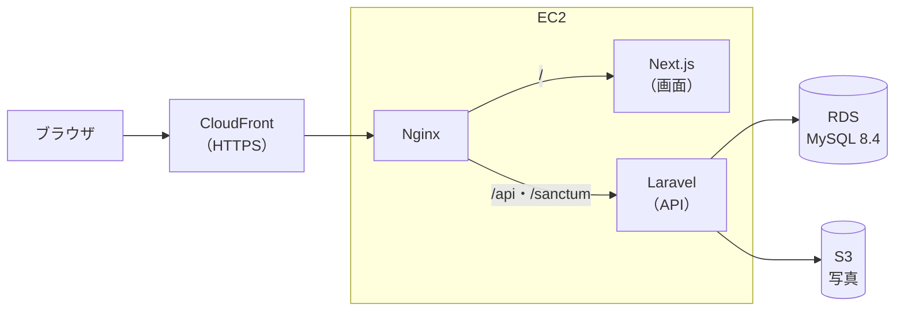

# Recipe Box（仮）

自分専用のレシピ管理 Web アプリです。料理名・材料・カテゴリ・タグからレシピをすぐに探せ、「作った記録」を残してレシピの改良や献立決めに役立てられます。

RaiseTech 初級編の最終課題として、**要件定義から設計・開発・AWS へのデプロイまでを一人で**進めています。

> **設計中です。** 要件定義と技術選定・画面設計が終わり、テーブル設計も終わりました。基本設計（API 設計など）を進めています。まだコードはありません（[進み具合](#進み具合)）。

## 主な機能（予定）

| 区分 | 機能 |
|---|---|
| レシピ | 登録・一覧・詳細・編集・削除、複製、お気に入り（★） |
| レシピの中身 | 料理名、カテゴリ、タグ、何人分、調理時間、材料（名前＋分量）、作り方（手順）、メモ、完成写真1枚 |
| 探す | 料理名・材料名でのキーワード検索、カテゴリ・タグ・調理時間・お気に入りでの絞り込み（組み合わせ可）、並び替え、20件ずつのページ分け |
| 表示 | 一覧はタイル（写真が大きい）とリストを切り替え。スマホ（横幅 320px〜）とパソコンの両方に対応。ダークモードは端末の設定に合わせる |
| 分類 | カテゴリは固定の12個（主菜・副菜・汁物など）、タグは自由に追加（入力すると新しいタグになり、使われなくなると自動で消える） |
| 作った記録 | 「作った」ボタンで日付とひとことメモを残す。作った回数・最後に作った日を表示 |
| アカウント | 持ち主1人だけが使う。ログイン（ログイン状態を長期間保持）、パスワード変更、ログインの回数制限 |

利用者は自分1人の想定なので、新規登録の画面はありません（アカウントはコマンドで作ります）。

## 使っている技術

初級編（React＋Vite＋Tailwind CSS、Java＋Spring Boot＋PostgreSQL）と**違う技術を使う**ことが課題の条件です。

| 区分 | 技術 |
|---|---|
| 画面 | Next.js 16・React 19・TypeScript 7・Mantine 9（部品集）・CSS Modules |
| サーバー | PHP 8.5・Laravel 13・Laravel Sanctum（ログイン） |
| データベース | MySQL 8.4 |
| テスト | Pest（サーバー）、Vitest・React Testing Library（画面）、Playwright（ブラウザでの通しのテスト） |
| 公開先 | AWS（CloudFront・EC2・RDS・S3） |
| その他 | Docker（開発用の DB）、GitHub（イシュー・プルリクエスト）、GitHub Actions（自動テスト） |

バージョンと選んだ理由は [技術スタック](docs/tech-stack.md) にあります。

## 構成（予定）

- 画面（Next.js）と API（Laravel）を同じドメインで配り、ログインはクッキーで行います（Sanctum の SPA 認証）
- 独自ドメインは使わず、CloudFront の URL で HTTPS にします

## 設計書

| 文書 | 内容 |
|---|---|
| [要件定義書](docs/requirements.md) | 目的、機能要件（F-xx）、非機能要件（N-xx）、対象外 |
| [技術スタック](docs/tech-stack.md) | 使う技術とバージョン、本番の構成 |
| [画面設計書](docs/screen-design.md) | 画面の一覧・移り変わり・見た目の決まり・画面ごとの内容 |
| [テーブル設計書](docs/database-design.md) | ER 図、テーブルの定義、索引、写真の保存、CRUD 表 |
| [モックアップ](docs/mockups/index.html) | 画面の見た目の試作（HTML。ダウンロードしてブラウザで開く） |

API 設計・AWS 構成図・詳細設計書は、これから作ります。

## 進み具合

| 工程 | 状態 |
|---|---|
| 要件定義 | ✅ 完了 |
| 基本設計：技術選定 | ✅ 完了 |
| 基本設計：画面設計・モックアップ | ✅ 完了 |
| 基本設計：テーブル設計 | ✅ 完了 |
| 基本設計：API 設計・AWS 構成図 | ⏳ これから |
| 詳細設計 | ⏳ これから |
| 環境構築・実装・テスト | ⏳ これから |
| AWS へのデプロイ | ⏳ これから |

## 開発環境の作り方

環境構築の工程で書きます。

## 作った人

[keiwebcreate](https://github.com/keiwebcreate)
