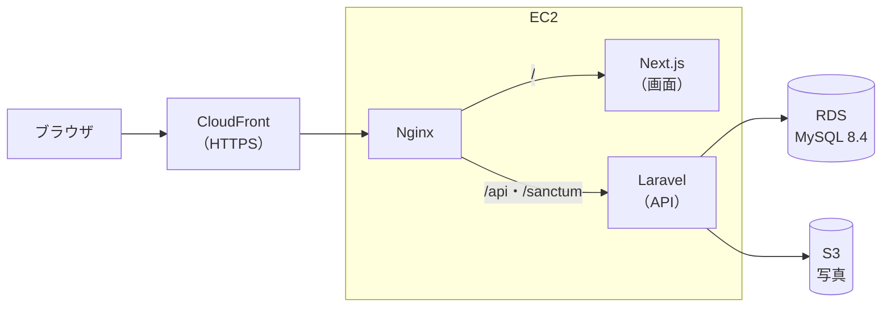

# Recipe Box

自分専用のレシピ管理 Web アプリです。料理名・材料・カテゴリ・タグからレシピをすぐに探せ、「作った記録」を残してレシピの改良や献立決めに役立てられます。

RaiseTech 初級編の最終課題として、**要件定義から設計・開発・AWS へのデプロイまでを一人で**行いました（[進み具合](#進み具合)）。

## 操作の動画（採点の方へ）

AWS に公開したアプリを、ブラウザで操作した様子です（約2分30秒、音声なし）。費用を抑えるため、提出のあとに AWS の環境は消しました。動画のアドレスバーの URL は開けないので、動作はこの動画でご確認ください。

https://github.com/user-attachments/assets/b4654e8c-5254-49c4-901c-8bcc54d295a8

再生できないときは、[動画のファイル](docs/demo/recipe-box-demo.mp4) をダウンロードしてご覧ください。

| 時間（おおよそ） | 映っている操作 |
|---|---|
| 0:00 | ログイン（パスワードは伏せ字） |
| 0:10 | レシピの一覧 |
| 0:16 | レシピの登録：料理名・カテゴリ・タグなどの入力 |
| 0:47 | 写真の選択（パソコンの情報が映るので、ファイルを選ぶ窓を灰色の四角で隠しています） |
| 1:16 | 入力の誤りの表示と、直して保存 |
| 1:24 | 登録したレシピの詳細、一覧に写真が出ること |
| 1:40 | レシピの削除（確認の窓） |
| 2:00 | レシピの編集と、詳細への反映 |
| 2:22 | 設定の画面、ログアウト |

動画にない機能（検索・絞り込み・お気に入り・作った記録など）は、[自動テスト](.github/workflows/ci.yml) で確かめています。

## 主な機能

| 区分 | 機能 |
|---|---|
| レシピ | 登録・一覧・詳細・編集・削除、複製、お気に入り（★） |
| レシピの中身 | 料理名、カテゴリ、タグ、何人分、調理時間、材料（名前＋分量）、作り方（手順）、メモ、完成写真1枚 |
| 探す | 料理名・材料名でのキーワード検索、カテゴリ・タグ・調理時間・お気に入りでの絞り込み（組み合わせ可）、並び替え、20件ずつのページ分け |
| 表示 | 一覧はタイル（写真が大きい）とリストを切り替え。スマホ（横幅 320px〜）とパソコンの両方に対応。ダークモードは端末の設定に合わせる |
| 分類 | カテゴリは固定の12個（主菜・副菜・汁物など）、タグは自由に追加（入力すると新しいタグになり、使われなくなると自動で消える） |
| 作った記録 | 「作った」ボタンで日付とひとことメモを残す。作った回数・最後に作った日を表示 |
| アカウント | 持ち主1人だけが使う。ログイン（ログイン状態を長期間保持）、パスワード変更、ログインの回数制限 |

利用者は自分1人の想定なので、新規登録の画面はありません（アカウントはコマンドで作ります）。

## 使っている技術

初級編（React＋Vite＋Tailwind CSS、Java＋Spring Boot＋PostgreSQL）と**違う技術を使う**ことが課題の条件です。

| 区分 | 技術 |
|---|---|
| 画面 | Next.js 16・React 19・TypeScript 7・Mantine 9（部品集）・CSS Modules・TanStack Query 5 |
| サーバー | PHP 8.5・Laravel 13・Laravel Sanctum（ログイン） |
| データベース | MySQL 8.4 |
| テスト | Pest（サーバー）、Vitest・React Testing Library（画面）、Playwright（ブラウザでの通しのテスト） |
| 公開先 | AWS（CloudFront・EC2・RDS・S3） |
| 構築 | Terraform、GitHub Actions（自動テスト・自動デプロイ）、Systems Manager（Session Manager・Run Command・Parameter Store） |
| その他 | Docker（開発用の DB）、GitHub（イシュー・プルリクエスト） |

バージョンと選んだ理由は [技術スタック](docs/tech-stack.md) にあります。

## 構成



- 画面（Next.js）と API（Laravel）を同じドメインで配り、ログインはクッキーで行います（Sanctum の SPA 認証）
- 独自ドメインは使わず、CloudFront の URL で HTTPS にしました
- 組織の制限で東京リージョンを使えないので、シドニー（`ap-southeast-2`）に作りました
- 構成は `terraform/`、EC2 の準備と配置の手順は `deploy/` にあります
- main にマージすると、CI の成功のあとに自動でデプロイしていました。失敗したら前の版に戻します
- 費用を抑えるため、確認と提出が済んだあと `terraform destroy` で全部消しました。自動デプロイも止めてあります

## 設計書

| 文書 | 内容 |
|---|---|
| [要件定義書](docs/requirements.md) | 目的、機能要件（F-xx）、非機能要件（N-xx）、対象外 |
| [技術スタック](docs/tech-stack.md) | 使う技術とバージョン、本番の構成 |
| [画面設計書](docs/screen-design.md) | 画面の一覧・移り変わり・見た目の決まり・画面ごとの内容 |
| [テーブル設計書](docs/database-design.md) | ER 図、テーブルの定義、索引、写真の保存、CRUD 表 |
| [API 設計書](docs/api-design.md) | API 18本の一覧、送る値・返す値、エラーの形、ログインの流れ |
| [AWS 構成設計書](docs/aws-design.md) | 構成図、ネットワーク、通信の許可、権限、自動デプロイの流れ、費用 |
| [詳細設計書](docs/detailed-design.md) | 開発環境、フォルダ構成、処理の流れ、ログイン、写真、テストの方針、デプロイの手順 |
| [モックアップ](docs/mockups/index.html) | 画面の見た目の試作（HTML。ダウンロードしてブラウザで開く） |

## 進み具合

| 工程 | 状態 |
|---|---|
| 要件定義 | ✅ 完了 |
| 基本設計：技術選定 | ✅ 完了 |
| 基本設計：画面設計・モックアップ | ✅ 完了 |
| 基本設計：テーブル設計・API 設計・AWS 構成 | ✅ 完了 |
| 詳細設計 | ✅ 完了 |
| 環境構築 | ✅ 完了（開発用の DB、Laravel・Next.js のひな形） |
| 実装・テスト | ✅ 完了（要件の機能すべて。サーバー・画面・ブラウザの通しのテスト） |
| AWS へのデプロイ | ✅ 完了（CloudFront の HTTPS で動作を確認。提出のあとに環境は削除） |

## 開発環境の作り方

Windows 11 で作っています。くわしくは [詳細設計書 3章](docs/detailed-design.md#3-開発環境)。

### 必要なもの

| 道具 | 版 | 使い道 |
|---|---|---|
| [Laravel Herd](https://herd.laravel.com/windows) | PHP 8.5 を入れておく（`php85` で呼べる。拡張機能 `intl`・`gd`・`exif`・`pdo_mysql`） | Laravel |
| [fnm](https://github.com/Schniz/fnm) | Node.js 24（`frontend/.node-version`） | Next.js |
| Docker Desktop | | 開発用の MySQL 8.4 |

### 最初の1回

1. Windows のユーザー環境変数 `RECIPE_DB_PASSWORD` に、開発用の DB のパスワード（自分で決める）を登録する
2. DB を起動する（リポジトリのルートで）

   ```powershell
   docker compose up -d
   ```

3. Laravel の準備（`backend/`）

   ```powershell
   php85 "$env:USERPROFILE\.config\herd\bin\composer.phar" install
   Copy-Item .env.example .env
   php85 artisan key:generate
   php85 artisan migrate --seed
   php85 artisan app:create-owner
   ```

   最後のコマンドは、ログインに使う持ち主のアカウントを作ります（メールアドレスとパスワードを聞かれます。アカウントは1つだけ）。

4. Next.js の準備（`frontend/`）

   ```powershell
   fnm use
   npm install
   ```

### 起動

| もの | 場所 | コマンド | ポート |
|---|---|---|---|
| DB | ルート | `docker compose up -d` | 3308 |
| Laravel | `backend/` | `pwsh ./serve.ps1`（写真を 5MB まで送れる設定で起動する） | 8000 |
| Next.js | `frontend/` | `npm run dev` | 3000 |

ブラウザで `http://localhost:3000` を開きます。`/api` と `/sanctum` は、Next.js が Laravel に転送します。

### テストとチェック

| 対象 | コマンド |
|---|---|
| Laravel のテスト（Pest） | `php85 artisan test` |
| Laravel の書き方（Pint）・型（Larastan） | `php85 vendor/bin/pint --test`・`php85 vendor/bin/phpstan analyse` |
| Next.js のテスト（Vitest） | `npm test` |
| Next.js の書き方・型（Biome・TypeScript） | `npm run lint`・`npm run typecheck` |
| 通しのテスト（Playwright） | `npx playwright install`（最初の1回）→ 3つを起動し、環境変数 `E2E_OWNER_EMAIL`・`E2E_OWNER_PASSWORD` に持ち主のメールアドレスとパスワードを入れて `npm run e2e` |

## 作った人

[keiwebcreate](https://github.com/keiwebcreate)
