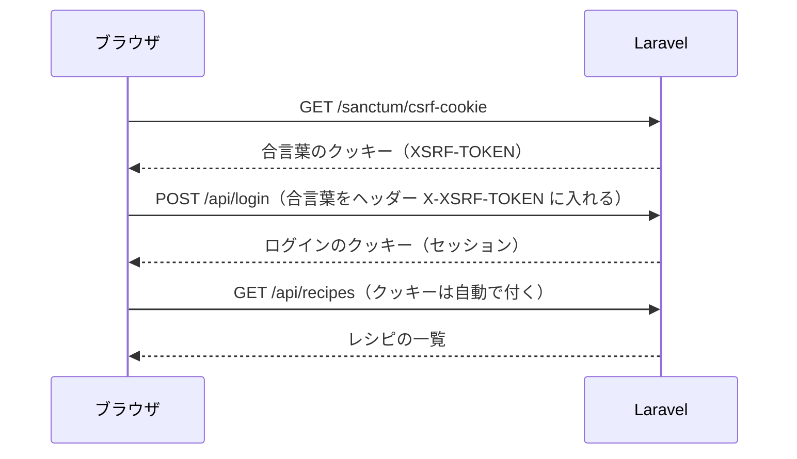

# API 設計書：レシピ管理アプリ

| 項目 | 内容 |
|---|---|
| 版 | 1.0 |
| 作成日 | 2026-11-03 |
| 状態 | 確定 |

画面（Next.js）がサーバー（Laravel）に「何を・どの URL で・どんな形で」頼むかを決める。もとにした文書：[要件定義書](requirements.md)、[画面設計書](screen-design.md)、[テーブル設計書](database-design.md)、[技術スタック](tech-stack.md)。

---

## 1. 共通の決まり

### 1.1 呼び方

| 項目 | 決まり |
|---|---|
| 呼ぶ場所 | **ブラウザから直接** `/api/...` を呼ぶ（質問3）。画面と API は同じドメインなので、ログインのクッキーはブラウザが自動で付ける |
| 例外 | ログインしていない人をログイン画面へ移す処理（F-61）だけは、Next.js のサーバーが画面を出す前に `GET /api/me` を1回呼んで確かめる |
| URL | `/api/` で始める。レシピは `/api/recipes`、1件は `/api/recipes/{id}`（REST の形） |
| 方法 | GET＝読む、POST＝作る、PUT＝丸ごと変える、DELETE＝消す |
| データの形 | JSON（文字コードは UTF-8）。写真を送る API だけ `multipart/form-data`（質問1） |
| 名前の付け方 | JSON のキーは英小文字とアンダースコア（`cook_minutes`）。テーブルの列名と同じにして、読み替えを減らす |
| 日付・日時 | 日付は `2026-11-03`、日時は `2026-11-03T21:15:00+09:00`（ISO 8601） |
| 空の値 | 値がないときは `null`（空の文字列にしない） |

### 1.2 ログインとなりすまし対策（Laravel Sanctum の SPA 認証）



- ログインのクッキーは JavaScript から読めない設定（HttpOnly）にする
- データを変える要求（POST・PUT・DELETE）には、毎回 `X-XSRF-TOKEN` ヘッダーを付ける。画面側は、API を呼ぶ関数を1か所にまとめ、そこで付ける
- ログインが必要な API をログインせずに呼ぶと、401 を返す。画面はログイン画面へ移す

### 1.3 状態番号とエラーの形

エラーは **Laravel の標準の形**で返す（質問2）。

| 番号 | 意味 | 返す形 | 画面の動き |
|---|---|---|---|
| 200 | 成功（データあり） | 各 API のとおり | |
| 201 | 作った | 作ったもの | 「保存しました」などの通知 |
| 204 | 成功（データなし） | なし | 通知 |
| 401 | ログインしていない | `{"message": "ログインしてください"}` | ログイン画面へ移す |
| 404 | 見つからない | `{"message": "見つかりません"}` | S-07 の 404 |
| 419 | 合言葉（CSRF）の期限切れ | `{"message": "..."}` | 合言葉をもらい直して、1回だけやり直す |
| 422 | 入力の誤り | 下の例 | 項目の下に赤い文字、フォームの上にまとめて表示 |
| 429 | 回数制限 | `{"message": "しばらく受け付けません。1分後にもう一度お試しください"}` | フォームの上に表示 |
| 500 | サーバーの不具合 | `{"message": "エラーが起きました"}`（詳しい中身は出さない） | 赤い通知、または S-07 の 500 |

入力の誤り（422）の例：

```json
{
  "message": "入力に誤りがあります",
  "errors": {
    "name": ["料理名を入力してください"],
    "ingredients.0.name": ["材料名は50文字までにしてください"]
  }
}
```

- `errors` のキーは、送った項目の名前。配列の何行目かは `ingredients.0.name` のように番号で表す（0 から数える）
- 文言は日本語。Laravel の言語ファイルで日本語にする

### 1.4 ページ分け

一覧は Laravel の標準のページ分けの形で返す。

```json
{
  "data": [ ... 20件 ... ],
  "meta": { "current_page": 1, "last_page": 2, "per_page": 20, "total": 24, "from": 1, "to": 20 }
}
```

### 1.5 写真の URL

- 写真は、**期限付きの URL**（60分で使えなくなる）で返す。本番は S3 の署名付き URL、開発は Laravel の署名付き URL
- 写真の置き場所（S3）は公開しない。URL を知られても、期限が切れれば見られない
- 写真がないときは `null`。画面は「No Image」の画像を表示する（F-23）

---

## 2. API の一覧

| # | 方法 | URL | 内容 | ログイン | 画面 |
|---|---|---|---|---|---|
| A-01 | GET | `/sanctum/csrf-cookie` | 合言葉のクッキーをもらう | 不要 | S-01 |
| A-02 | POST | `/api/login` | ログイン | 不要 | S-01 |
| A-03 | POST | `/api/logout` | ログアウト | 必要 | S-06 |
| A-04 | GET | `/api/me` | ログイン中の持ち主 | 必要 | 全画面 |
| A-05 | PUT | `/api/me/password` | パスワード変更 | 必要 | S-06 |
| A-06 | GET | `/api/categories` | カテゴリ12個 | 必要 | S-02・S-04・S-05 |
| A-07 | GET | `/api/tags` | タグの一覧 | 必要 | S-02・S-04・S-05 |
| A-08 | GET | `/api/recipes` | レシピ一覧（検索・絞り込み・並び替え・ページ） | 必要 | S-02 |
| A-09 | GET | `/api/recipes/{id}` | レシピ詳細 | 必要 | S-03・S-05 |
| A-10 | POST | `/api/recipes` | レシピ登録 | 必要 | S-04 |
| A-11 | POST（PUT として扱う） | `/api/recipes/{id}` | レシピ編集 | 必要 | S-05 |
| A-12 | DELETE | `/api/recipes/{id}` | レシピ削除 | 必要 | D-01 |
| A-13 | PUT | `/api/recipes/{id}/favorite` | お気に入りを付ける | 必要 | S-02・S-03 |
| A-14 | DELETE | `/api/recipes/{id}/favorite` | お気に入りを外す | 必要 | S-02・S-03 |
| A-15 | POST | `/api/recipes/{id}/copy` | レシピ複製 | 必要 | D-04 |
| A-16 | GET | `/api/recipes/{id}/cooking-logs` | 作った記録の全部 | 必要 | S-03 |
| A-17 | POST | `/api/recipes/{id}/cooking-logs` | 作った記録の追加 | 必要 | D-02 |
| A-18 | DELETE | `/api/cooking-logs/{id}` | 作った記録の削除 | 必要 | D-03 |

---

## 3. API ごとの中身

### A-02 ログイン `POST /api/login`

送る値：

| 項目 | 型 | 必須 | 決まり |
|---|---|---|---|
| `email` | 文字 | ○ | メールアドレスの形 |
| `password` | 文字 | ○ | |
| `remember` | 真偽 | | true なら「ログイン状態を保持する」 |

返す値：成功は **204**。失敗は 422（`{"message": "メールアドレスかパスワードが違います"}`。どちらが違うかは教えない）。同じメールアドレスと接続元からの失敗が1分に5回を超えたら 429（N-23）。

- ログインに成功したら、セッションの番号を作り直す（他人に番号を仕込まれる攻撃を防ぐ）

### A-03 ログアウト `POST /api/logout`

送る値：なし。返す値：**204**。セッションを消し、合言葉も作り直す。

### A-04 ログイン中の持ち主 `GET /api/me`

返す値（200）：

```json
{ "email": "you@example.com" }
```

ログインしていなければ 401。

### A-05 パスワード変更 `PUT /api/me/password`

| 項目 | 型 | 必須 | 決まり |
|---|---|---|---|
| `current_password` | 文字 | ○ | 今のパスワードと合っていること |
| `password` | 文字 | ○ | 8文字以上、255文字まで |
| `password_confirmation` | 文字 | ○ | `password` と同じ |

返す値：**204**。ほかのブラウザ・端末のログインは切る（今の画面はそのまま使える）。

### A-06 カテゴリ `GET /api/categories`

返す値（200）：並び順（`sort_order`）のとおり。

```json
{ "data": [ { "id": 1, "name": "主菜" }, { "id": 2, "name": "副菜" } ] }
```

### A-07 タグ `GET /api/tags`

返す値（200）：名前の順。使っているレシピの数も返す（絞り込みの候補で「和食 (12)」のように出せる）。

```json
{ "data": [ { "id": 3, "name": "時短", "recipes_count": 8 }, { "id": 1, "name": "和食", "recipes_count": 12 } ] }
```

### A-08 レシピ一覧 `GET /api/recipes`

送る値（URL の後ろに付ける。例：`/api/recipes?q=豚肉&category_id=1&sort=name&page=2`）。すべて任意で、組み合わせられる。

| 項目 | 型 | 決まり | 要件 |
|---|---|---|---|
| `q` | 文字 | 100文字まで。料理名・よみがな・材料名の部分一致。前後の空白は取り除く | F-11 |
| `category_id` | 数 | カテゴリの ID | F-12 |
| `tag_id` | 数 | タグの ID | F-13 |
| `favorite` | 1 | 1 ならお気に入りだけ | F-14 |
| `max_minutes` | 数 | 15・30・60 のどれか。調理時間がこれ以下 | F-15 |
| `sort` | 文字 | `newest`（新しい順、初期値）・`name`（料理名順）・`cook_minutes`（調理時間の短い順）・`last_cooked`（最後に作った日が古い順） | F-16 |
| `page` | 数 | 1から。20件ずつ | F-17 |

並び替えの細かい決まり：

| `sort` | 並べ方 | 同じ値のとき |
|---|---|---|
| `newest` | 登録日時の新しい順 | ID の大きい順 |
| `name` | よみがながあればよみがな、なければ料理名の順 | ID の小さい順 |
| `cook_minutes` | 調理時間の短い順。調理時間が空のものは最後 | 新しい順 |
| `last_cooked` | 最後に作った日の古い順。一度も作っていないものを最初に出す（しばらく作っていない＝作っていないものから見せる） | 新しい順 |

返す値（200）：1.4 の形。`data` の1件の中身：

```json
{
  "id": 12,
  "name": "肉じゃが",
  "category": { "id": 1, "name": "主菜" },
  "cook_minutes": 30,
  "tags": [ { "id": 1, "name": "和食" }, { "id": 5, "name": "作り置き" } ],
  "is_favorite": true,
  "thumb_url": "https://…（期限付き。一覧用 400px）",
  "last_cooked_on": "2026-11-03"
}
```

- 送る値が決まりに合わないとき（`sort=abc` など）は 422

### A-09 レシピ詳細 `GET /api/recipes/{id}`

返す値（200）：

```json
{
  "id": 12,
  "name": "肉じゃが",
  "name_kana": "にくじゃが",
  "category": { "id": 1, "name": "主菜" },
  "servings": 2,
  "cook_minutes": 30,
  "memo": "砂糖は少なめでもちょうどよい。",
  "is_favorite": true,
  "photo_url": "https://…（期限付き。詳細用 1200px）",
  "thumb_url": "https://…（期限付き。一覧用 400px）",
  "tags": [ { "id": 1, "name": "和食" } ],
  "ingredients": [ { "name": "じゃがいも", "quantity": "3個" }, { "name": "塩", "quantity": null } ],
  "steps": [ { "body": "じゃがいもは皮をむいて4等分に切る。" } ],
  "cooking": {
    "count": 5,
    "last_cooked_on": "2026-11-03",
    "recent_logs": [ { "id": 31, "cooked_on": "2026-11-03", "note": "塩を減らしたらちょうどよかった" } ]
  },
  "created_at": "2026-10-01T20:00:00+09:00",
  "updated_at": "2026-11-03T21:15:00+09:00"
}
```

- `ingredients`・`steps` は並び順のとおりに並べる（画面の手順番号は、配列の何番目かで決まる）
- `recent_logs` は新しい順に3件まで（画面設計書 S-03）
- ない ID なら 404

### A-10 レシピ登録 `POST /api/recipes`

写真があるので `multipart/form-data` で送る（質問1）。

| 項目 | 型 | 必須 | 決まり（要件 3章・テーブル設計書 3.3〜3.7） |
|---|---|---|---|
| `name` | 文字 | ○ | 100文字まで |
| `name_kana` | 文字 | | ひらがな（と「ー」・空白）で100文字まで |
| `category_id` | 数 | ○ | 存在するカテゴリの ID |
| `servings` | 数 | ○ | 1〜99 |
| `cook_minutes` | 数 | | 1〜999 |
| `memo` | 文字 | | 2000文字まで |
| `tags[]` | 文字の並び | | 10個まで。1つ20文字まで。重なりは1つにまとめる。まだない名前は新しいタグになる（F-32） |
| `ingredients[0][name]` … | 文字 | ○（1行以上） | 50行まで。名前は50文字まで |
| `ingredients[0][quantity]` … | 文字 | | 30文字まで |
| `steps[0][body]` … | 文字 | ○（1行以上） | 50行まで。1行500文字まで |
| `photo` | ファイル | | JPEG・PNG・WebP、5MB まで。中身が本当に画像かを確かめる（N-27） |

返す値：**201**。中身は A-09 と同じ形（登録したレシピ）。画面はその `id` で詳細画面へ移る。

- 文字の前後の空白は取り除く。空の行（材料名が空の行など）は送らない（画面で取り除く）
- 1つのトランザクションで、レシピ・材料・手順・タグをまとめて保存する。写真の保存に失敗したら全部取り消す

### A-11 レシピ編集 `POST /api/recipes/{id}`（PUT として扱う）

本来は PUT だが、PHP は `multipart/form-data` の PUT を読めないため、**POST で送り、`_method=PUT` を付ける**（Laravel の決まった方法）。

送る値：A-10 と同じ項目に、次を足す。

| 項目 | 型 | 必須 | 決まり |
|---|---|---|---|
| `_method` | 文字 | ○ | `PUT` |
| `remove_photo` | 真偽 | | true なら写真を消す（`photo` を送ったときは無視） |

- 写真：`photo` を送れば差し替え、`remove_photo=true` なら削除、どちらもなければ今の写真のまま
- 材料・手順・タグは、送った内容に丸ごと置き換える
- 使われなくなったタグは、同じトランザクションの中で消す（F-33）

返す値：**200**。中身は A-09 と同じ形。

### A-12 レシピ削除 `DELETE /api/recipes/{id}`

返す値：**204**。材料・手順・タグとのつながり・作った記録はデータベースが一緒に消す。写真の2枚と、使われなくなったタグはアプリが消す（テーブル設計書 5章）。

### A-13・A-14 お気に入り `PUT`／`DELETE /api/recipes/{id}/favorite`

送る値：なし。返す値（200）：`{"is_favorite": true}`（外したときは false）。何度呼んでも同じ結果になる。

### A-15 レシピ複製 `POST /api/recipes/{id}/copy`

送る値：なし。返す値：**201**。中身は A-09 と同じ形（作った複製）。画面はその `id` で編集画面（S-05）を開く。

- 料理名の後ろに「（コピー）」を付ける。100文字を超えるときは、料理名の後ろを削ってから付ける
- 写真は2枚とも新しい名前でコピーする。お気に入りと作った記録はコピーしない（要件 4.3）

### A-16 作った記録の全部 `GET /api/recipes/{id}/cooking-logs`

返す値（200）：新しい順（同じ日は作った順の逆）。ページ分けはしない（1レシピに数百件までの想定）。

```json
{ "data": [ { "id": 31, "cooked_on": "2026-11-03", "note": "塩を減らしたらちょうどよかった" } ] }
```

### A-17 作った記録の追加 `POST /api/recipes/{id}/cooking-logs`

| 項目 | 型 | 必須 | 決まり |
|---|---|---|---|
| `cooked_on` | 日付 | ○ | 今日（日本時間）より後の日付は受け付けない |
| `note` | 文字 | | 200文字まで |

返す値：**201**。`{"id": 32, "cooked_on": "2026-11-03", "note": null}`

### A-18 作った記録の削除 `DELETE /api/cooking-logs/{id}`

返す値：**204**。

---

## 4. 画面と API の対応

| 画面・操作 | 使う API |
|---|---|
| 画面を開く前（Next.js のサーバー） | A-04 |
| S-01 ログイン | A-01 → A-02 |
| S-02 一覧 | A-06・A-07・A-08、★ は A-13／A-14 |
| S-03 詳細 | A-09、★ は A-13／A-14、「ほかの記録を表示」は A-16 |
| S-04 登録 | A-06・A-07 → A-10 |
| S-05 編集 | A-06・A-07・A-09 → A-11 |
| D-01 削除 | A-12 |
| D-02 作った記録の追加 | A-17 |
| D-03 作った記録の削除 | A-18 |
| D-04 複製 | A-15 → S-05 へ |
| S-06 設定 | A-04・A-05・A-03 |

---

## 5. この文書で新しく決めたこと

質問で決めた3点（写真はレシピと一緒に送る、エラーは Laravel の標準の形、ブラウザから直接呼ぶ）のほかに、この文書で決めた点。2026-11-03 にユーザーの確認を受けた。

| 場所 | 内容 |
|---|---|
| 1.1 | JSON のキーはテーブルの列名と同じ（英小文字とアンダースコア） |
| 1.5 | 写真は60分で使えなくなる期限付きの URL で返す。S3 は公開しない |
| A-02 | ログインの失敗は、同じメールアドレスと接続元から1分に5回まで |
| A-05 | パスワードを変えたら、ほかのブラウザ・端末のログインを切る |
| A-07 | タグの一覧に、使っているレシピの数も返す |
| A-08 | 「最後に作った日が古い順」では、一度も作っていないレシピを最初に出す。調理時間の短い順では、調理時間が空のレシピを最後に出す |
| A-11 | 編集は POST に `_method=PUT` を付けて送る（PHP の決まりのため） |
| A-15 | 複製で料理名が100文字を超えるときは、元の料理名の後ろを削って「（コピー）」を付ける |

---

## 6. 改訂履歴

| 版 | 日付 | 内容 |
|---|---|---|
| 0.1 | 2026-11-03 | 質問形式（質問1〜3）で決めた内容をもとに作成 |
| 1.0 | 2026-11-03 | ユーザーの確認（5章を含む）を受けて確定 |
