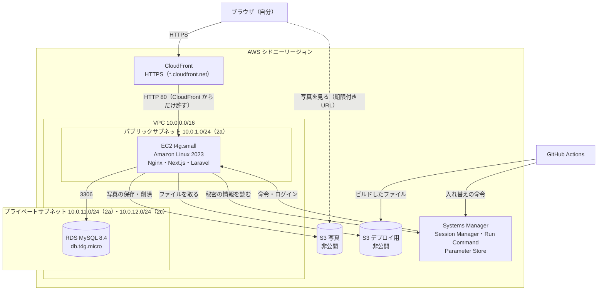
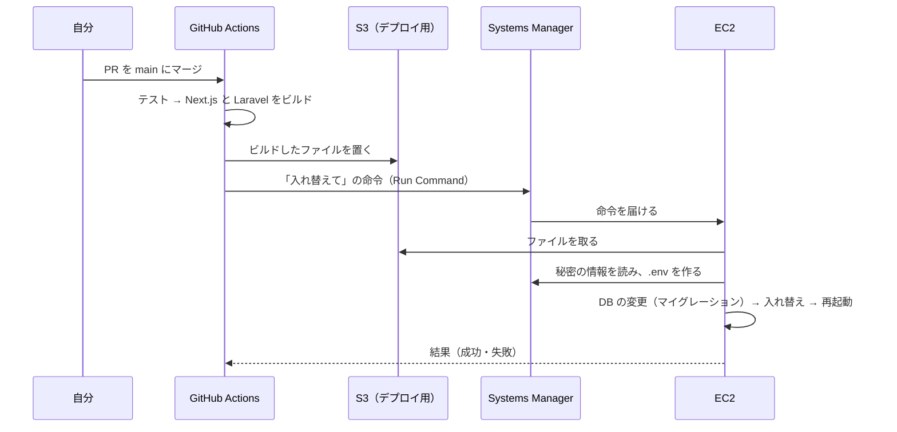

# AWS 構成設計書：レシピ管理アプリ

| 項目 | 内容 |
|---|---|
| 版 | 1.5 |
| 作成日 | 2026-11-03 |
| 状態 | 確定 |
| リージョン | シドニー（`ap-southeast-2`）。組織の制限（SCP）で東京などは使えない |

本番環境（AWS）の構成を決める。もとにした文書：[技術スタック](tech-stack.md)（3章 本番の構成）、[要件定義書](requirements.md)（5章 非機能要件）、[API 設計書](api-design.md)（1.5 写真の期限付き URL）。作る手順そのものは、詳細設計とデプロイの工程で手順書にする。

---

## 1. 決めたこと

| # | 項目 | 決定 | 理由 |
|---|---|---|---|
| 1 | 作り方 | **Terraform**（構成を `.tf` ファイルに書いて作る）と AWS CLI | 作り直し・片付けがコマンド1つ。Git に履歴が残る |
| 2 | EC2 の大きさ | **t4g.small**（ARM・メモリ 2GB） | Nginx・Next.js・Laravel を同時に動かすため、メモリに余裕を持たせる |
| 3 | EC2 へのログイン | **Session Manager**。SSH は使わず、ポート22は開けない | 外に開いた入口を減らす。鍵ファイルの管理がいらない。前のアプリと違う形を経験する |
| 4 | デプロイ | **GitHub Actions → S3 → Systems Manager** で自動。main にマージすると本番が新しくなる | SSH を使わずに載せられる。ビルドを EC2 の外で行うので、メモリ不足を防げる |
| 5 | 秘密の情報 | **Systems Manager の Parameter Store**（暗号化して保存） | 無料。3・4 と同じ Systems Manager の仲間で、仕組みがそろう |
| 6 | 運用 | **課題を提出したら、すぐに `terraform destroy` で全部消す** | 120ドルのクレジットを使い切らないため（8章） |

---

## 2. 構成図



EC2 の中：

```
CloudFront ─80─▶ Nginx ─┬─ /                    → Next.js（Node.js・3000。外には開けない）
                        └─ /api/・/sanctum/      → Laravel（PHP-FPM）
```

---

## 3. ネットワーク

| 部品 | 決まり | 理由 |
|---|---|---|
| VPC | `10.0.0.0/16` | 自分専用のネットワーク |
| パブリックサブネット | `10.0.1.0/24`（ap-southeast-2a）。EC2 を置く | CloudFront からの通信を受け、外（Systems Manager・S3）へも出られる |
| プライベートサブネット | `10.0.11.0/24`（2a）と `10.0.12.0/24`（2c）。RDS を置く | インターネットから直接届かない場所に DB を置く。RDS は2つの場所（AZ）にサブネットを用意する決まりがある（DB を置くのは1つだけ） |
| インターネットゲートウェイ | パブリックサブネットだけが使う | |
| NAT ゲートウェイ | **置かない** | 月30ドル以上かかる。RDS は外に出る必要がないので不要 |
| 固定の IP アドレス（Elastic IP） | EC2 に付ける | EC2 を止めて動かしても住所が変わらず、CloudFront の転送先を直さなくてよい |

---

## 4. 通信の許可（セキュリティグループ）

書いていない通信はすべて通さない。

| 相手 | 向き | ポート | 許す相手 | 理由 |
|---|---|---|---|---|
| EC2 | 入る | 80 | **CloudFront だけ**（AWS が用意する CloudFront の IP アドレスの一覧） | EC2 を直接開いて、HTTPS を通らずに使われるのを防ぐ（N-21） |
| EC2 | 入る | 22 | **開けない** | Session Manager を使うため |
| EC2 | 出る | すべて | どこへでも | Systems Manager・S3・パッケージの取得に使う |
| RDS | 入る | 3306 | **EC2 のセキュリティグループだけ** | DB には EC2 からしか届かない |

- 念のため、CloudFront から EC2 への転送に秘密のヘッダーを付け、Nginx はそのヘッダーがない要求を断る（CloudFront を他人が作って、こちらの EC2 に向けるのを防ぐ）

---

## 5. 各部品の設定

### 5.1 CloudFront

| 項目 | 決まり |
|---|---|
| 住所 | `https://xxxx.cloudfront.net`（独自ドメインは使わない） |
| HTTP で来たら | HTTPS に移す（N-21） |
| 転送先 | EC2（固定の IP アドレスの DNS 名）の 80番 |
| 保存（キャッシュ） | `/_next/static/*`（画面の部品のファイル。名前が中身ごとに変わる）だけ長く保存する。それ以外（画面・`/api`）は**保存しない**（ログインした人ごとに中身が違うため） |
| 渡すもの | クッキー・URL の後ろの値・ヘッダーをすべて EC2 に渡す（ログインと CSRF に必要） |

### 5.2 EC2

| 項目 | 決まり |
|---|---|
| 種類 | t4g.small（ARM・2GB）。ディスクは 20GB（gp3・暗号化） |
| OS | Amazon Linux 2023 |
| 入れるもの | Nginx、Node.js 24（Amazon Linux の公式の `nodejs24`）、PHP 8.5（`php8.5`・PHP-FPM・`intl`・`gd` など）、Systems Manager のエージェント（OS に最初から入っている） |
| 動かし方 | Next.js と PHP-FPM は systemd（OS の常駐の仕組み）で動かし、落ちたら自動で起き直す |
| 権限 | 6章の「EC2 の役割」を付ける。AWS の鍵ファイルは EC2 に置かない |

- 詳細設計で確かめた結果、Amazon Linux 2023 には PHP 8.5 はあるが、Node.js 26 はまだない（20・22・24 だけ）。そのため開発も本番も Node.js 24 にした（詳細設計書 2.2）

### 5.3 RDS

| 項目 | 決まり |
|---|---|
| 種類 | db.t4g.micro、MySQL 8.4、1か所（シングル AZ） |
| ディスク | 20GB（gp3・暗号化） |
| 置き場所 | プライベートサブネット。インターネットからは見えない設定（パブリックアクセスなし） |
| バックアップ | 自動バックアップを7日分（N-31） |
| 文字コード | `utf8mb4`・照合順序 `utf8mb4_ja_0900_as_cs`（テーブル設計書 1章） |
| 消すとき | 最後のスナップショット（DB の写し）は**作らない**（課題の提出後に全部消す方針のため） |

### 5.4 S3

| バケット | 中身 | 決まり |
|---|---|---|
| 写真用 | レシピの写真（`recipes/large/`・`recipes/thumb/`） | 公開しない（公開のブロックをすべてオン）。暗号化。画面には60分で使えなくなる URL で見せる（API 設計書 1.5） |
| デプロイ用 | GitHub Actions がビルドしたファイル | 公開しない。30日たったファイルは自動で消す |

- どちらも、`terraform destroy` のときに中身ごと消せる設定にする

### 5.5 Parameter Store（秘密の情報）

`/recipe-app/prod/` の下に、暗号化して（SecureString）保存する。

| 名前 | 中身 | 作り方 |
|---|---|---|
| `APP_KEY` | Laravel の暗号化の鍵 | Terraform が作って入れる。`terraform destroy` で一緒に消せる。state には残さない |
| `DB_PASSWORD` | RDS のパスワード | Terraform がばらばらの文字列を作って入れる。`ephemeral` と書き込み専用の項目を使い、state には残さない |
| `DB_HOST`・`DB_PORT`・`DB_DATABASE`・`DB_USERNAME`・`AWS_BUCKET`・`AWS_DEFAULT_REGION`・`APP_URL`・`SANCTUM_STATEFUL_DOMAINS` | 接続先など（秘密ではないが一緒に置く） | Terraform が入れる |
| `ORIGIN_SECRET` | CloudFront から EC2 への秘密のヘッダー（4章）の値 | Terraform が作って入れる。CloudFront の設定に書く必要があるので、この値だけは state に残る |

- デプロイのたびに、EC2 がここから読んで Laravel の `.env` を作る。`.env` は EC2 の外に出さない
- Terraform の記録（state）は Git に入れない（前のアプリと同じ）
- アプリは RDS の管理者ユーザー `recipe_app_user` でつなぐ。提出したらすぐ消す前提なので、権限の狭いユーザーを別に作る手順は増やさない

---

## 6. 権限（IAM）

必要な操作だけを許す（最小の権限）。

| 役割 | 使う人・物 | 許すこと |
|---|---|---|
| EC2 の役割 | EC2 | Session Manager・Run Command で操作される（AWS の標準の権限）。写真用バケットの読み書き・削除。デプロイ用バケットの読み取り。`/recipe-app/prod/` のパラメータの読み取り |
| デプロイ専用の IAM ユーザー `recipe-app-deploy` | GitHub Actions | デプロイ用バケットへの書き込み。この EC2 への入れ替えの命令（Run Command）と、その結果の確認 |
| 作業用の IAM ユーザー | 自分（Terraform・AWS CLI） | 構成を作る・消す |

- EC2 の役割に付ける AWS 標準の権限（`AmazonSSMManagedInstanceCore`）は、パラメータの読み取りをすべてのパラメータに許す。このアカウントのシドニーには、このアプリのパラメータしかないので、そのまま使う
- GitHub Actions には、デプロイ専用の IAM ユーザーの鍵を、GitHub の秘密の情報として渡す。**OIDC**（GitHub と AWS が互いを確かめ合う仕組み）を予定していたが、組織の制限で OIDC の一覧の取得が拒否され、作成も権限の試算で拒否と出たので、ユーザーの決定で変更した（2026-11-07）
- デプロイが動くのは、このリポジトリの main からだけ（`deploy.yml` の条件）。鍵は Terraform で作らず（state に残るため）、ユーザーが AWS CLI で作って GitHub に直接渡す。提出後に `terraform destroy` と `gh secret delete` で消す
- この鍵を持つ人は、EC2 で命令を動かせる。全部消す前提の環境なので、この範囲で受け入れる

---

## 7. デプロイの流れ



- テストに失敗したら、ビルドもデプロイもしない
- 細かい手順（入れ替えの順番、失敗したときの戻し方）は詳細設計で決める

---

## 8. 費用と片付け

### 8.1 見込み（24時間動かした場合）

| 部品 | 月の目安 |
|---|---|
| EC2（t4g.small） | 約16ドル |
| RDS（db.t4g.micro・20GB） | 約20ドル |
| 固定の IP アドレス | 約4ドル |
| S3・CloudFront・Parameter Store | ほぼ0ドル |
| **合計** | **約40ドル** |

無料プランのクレジットは120ドル（期限 2027-05-03）。24時間動かし続けると3か月ほどで使い切る（N-34）。

### 8.2 費用を抑える決まり

| 決まり | 内容 |
|---|---|
| 必要なときだけ作る | 作って確かめる段階ごとに作り、使わない日が続くときは消す |
| **提出したらすぐ消す** | 課題を提出したら `terraform destroy` で全部消す（ユーザーの決定） |
| 予算の通知 | AWS Budgets で、月10ドル・20ドルを超えそうになったらメールで知らせる |
| NAT ゲートウェイは使わない | 3章 |

---

## 9. 作る段階

一度にすべてを作らず、段階ごとに作って確かめる（講座と前のアプリの進め方）。1つの段階を1つのイシューにする。

| 段階 | 作るもの | 確かめること |
|---|---|---|
| 1 | VPC・サブネット・セキュリティグループ・EC2（Session Manager で入れる） | Session Manager で EC2 に入れる |
| 2 | RDS・S3・Parameter Store・EC2 の役割 | EC2 から DB につながる。S3 に書ける |
| 3 | GitHub Actions のデプロイ（デプロイ専用の IAM ユーザー） | main にマージすると、EC2 で新しい版が動く |
| 4 | CloudFront | `https://xxxx.cloudfront.net` でログイン画面が出る。EC2 を直接開いても使えない |

---

## 10. 非機能要件との対応

| 要件 | どこで満たすか |
|---|---|
| N-21 HTTPS | CloudFront（5.1）。EC2 は CloudFront からしか受けない（4章） |
| N-26 秘密の情報を Git に入れない | Parameter Store（5.5）、GitHub Actions の鍵は GitHub の秘密の情報（6章）、state は Git に入れない |
| N-31 バックアップ7日分 | RDS の自動バックアップ（5.3） |
| N-34 費用 | 8章 |

---

## 11. この文書で新しく決めたこと

質問で決めた5点（1章の 1〜5）と「提出したらすぐ消す」のほかに、この文書で決めた点。2026-11-03 にユーザーの確認を受けた。

| 場所 | 内容 |
|---|---|
| 3章 | NAT ゲートウェイは置かない。EC2 に固定の IP アドレスを付ける |
| 4章 | EC2 の80番は CloudFront からだけ許す。さらに秘密のヘッダーで確かめる |
| 5.1 | CloudFront は `/_next/static/*` だけ保存し、ほかは保存しない |
| 5.3 | RDS は1か所（シングル AZ）。消すときに最後の写しは作らない |
| 5.4 | S3 は写真用とデプロイ用の2つに分ける。デプロイ用のファイルは30日で消す |
| 8.2 | AWS Budgets で月10ドル・20ドルの通知を出す |
| 9章 | 4つの段階に分けて作る |

---

## 12. 改訂履歴

| 版 | 日付 | 内容 |
|---|---|---|
| 0.1 | 2026-11-03 | 質問形式（質問1〜5）で決めた内容をもとに作成 |
| 1.0 | 2026-11-03 | ユーザーの確認（11章を含む）を受けて確定 |
| 1.1 | 2026-11-03 | 詳細設計の確認の結果を反映：Node.js を 24 に、照合順序を `utf8mb4_ja_0900_as_cs` に |
| 1.2 | 2026-11-07 | リージョンを東京からシドニーに変更（組織の制限のため）。OIDC が使えない見込みを6章に記載 |
| 1.3 | 2026-11-07 | 段階2の実装に合わせて、5.5（パスワードを state に残さない書き方、パラメータの名前、DB のユーザー）を更新 |
| 1.4 | 2026-11-07 | 段階3の実装に合わせて、5.5（`APP_KEY` の作り方）・6章（OIDC からデプロイ専用の IAM ユーザーに変更）を更新 |
| 1.5 | 2026-11-07 | 段階4の実装に合わせて、5.5（秘密のヘッダーの値）・9章・10章を更新 |
