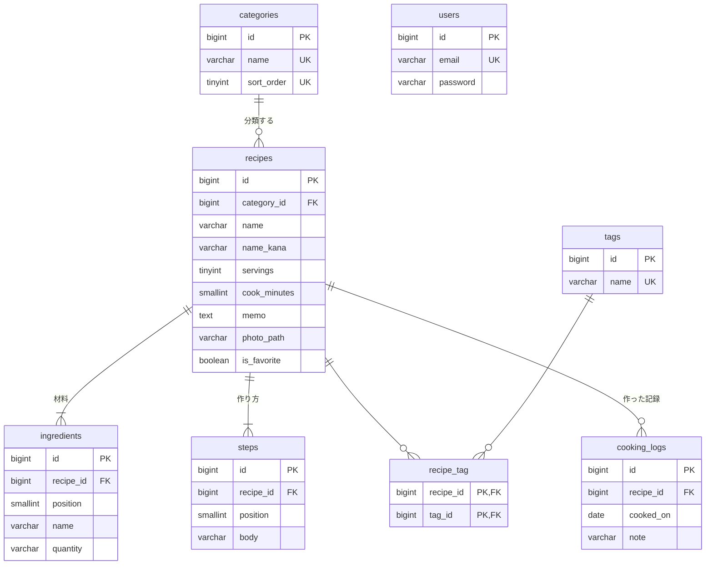

# テーブル設計書：レシピ管理アプリ

| 項目 | 内容 |
|---|---|
| 版 | 1.1 |
| 作成日 | 2026-11-03 |
| 状態 | 確定 |
| データベース | MySQL 8.4（開発は Docker、本番は RDS） |

要件定義書（[requirements.md](requirements.md)）と画面設計書（[screen-design.md](screen-design.md)）をもとに、データの持ち方を決める。テーブルは Laravel のマイグレーションで作る。

---

## 1. 共通の決まり

| 項目 | 決まり | 理由 |
|---|---|---|
| 名前の付け方 | テーブルは英小文字の複数形（`recipes`）、列は英小文字とアンダースコア（`cook_minutes`）。つなぐ表は2つの単数形をアルファベット順に（`recipe_tag`） | Laravel の決まりに合わせると、書く設定が減る |
| 主キー | `id`：`BIGINT UNSIGNED`・自動で番号を振る | Laravel の標準。利用者が自分だけなので、URL に番号が出ても困らない |
| 日時の列 | `created_at`・`updated_at`（Laravel が自動で入れる） | |
| 文字コード | `utf8mb4` | 絵文字や旧字も保存できる |
| 照合順序（文字の比べ方） | `utf8mb4_ja_0900_as_cs`（日本語用） | ひらがなとカタカナは同じとみなし、濁点・半濁点・小さい字は区別する。全角・半角は保存する前にそろえ、英字の大文字・小文字は検索のときだけ区別しない（詳細設計書 2.1・4.3）。これで質問4の決定を、濁点の問題なしで実現する |
| 外部キー | つながりはすべて外部キーで守る。親を消したときの動きは 5章 | 存在しないレシピの材料などができないようにする |
| 持ち主の列 | レシピ・タグなどに `user_id` は付けない | 利用者は持ち主1人だけ（質問1）。ログインしているかどうかだけを確かめる |

---

## 2. ER 図

- `users` はほかのテーブルとつながらない（質問1）
- 「1対多」：1つのレシピに材料・手順・作った記録が複数
- 「多対多」：レシピとタグ。間に `recipe_tag` を置いてつなぐ

---

## 3. テーブルの定義

「NULL」は「空のままでよいか」。○ は空でよい。

### 3.1 `users`（持ち主のアカウント）

Laravel が最初から用意するテーブルをそのまま使う。行は1つだけ（コマンドで作る。F-54）。

| 論理名 | 物理名 | 型 | NULL | 初期値 | 制約・説明 |
|---|---|---|---|---|---|
| ID | `id` | BIGINT UNSIGNED | | 自動 | 主キー |
| 名前 | `name` | VARCHAR(255) | | | Laravel の標準の列。画面には出さない |
| メールアドレス | `email` | VARCHAR(255) | | | 重なりなし（ログインに使う） |
| メール確認日時 | `email_verified_at` | TIMESTAMP | ○ | | Laravel の標準の列。使わない |
| パスワード | `password` | VARCHAR(255) | | | ハッシュ（元に戻せない形）で保存（N-22） |
| ログイン保持の印 | `remember_token` | VARCHAR(100) | ○ | | 「ログイン状態を保持する」で使う |
| 作成・更新日時 | `created_at`・`updated_at` | TIMESTAMP | ○ | | |

### 3.2 `categories`（カテゴリ）

固定の12個をシーダーで入れる（要件 4.1）。画面からは変えない。

| 論理名 | 物理名 | 型 | NULL | 初期値 | 制約・説明 |
|---|---|---|---|---|---|
| ID | `id` | BIGINT UNSIGNED | | 自動 | 主キー |
| 名前 | `name` | VARCHAR(30) | | | 重なりなし（例：主菜） |
| 並び順 | `sort_order` | TINYINT UNSIGNED | | | 重なりなし。選ぶ欄に出す順（1〜12） |
| 作成・更新日時 | `created_at`・`updated_at` | TIMESTAMP | ○ | | |

### 3.3 `recipes`（レシピ）

| 論理名 | 物理名 | 型 | NULL | 初期値 | 制約・説明 |
|---|---|---|---|---|---|
| ID | `id` | BIGINT UNSIGNED | | 自動 | 主キー |
| カテゴリ | `category_id` | BIGINT UNSIGNED | | | 外部キー → `categories.id` |
| 料理名 | `name` | VARCHAR(100) | | | 100文字まで |
| よみがな | `name_kana` | VARCHAR(100) | ○ | | ひらがなで入れる（例：にくじゃが）。料理名順の並び替えと検索に使う（質問5） |
| 何人分 | `servings` | TINYINT UNSIGNED | | | 1〜99 |
| 調理時間（分） | `cook_minutes` | SMALLINT UNSIGNED | ○ | | 1〜999 |
| メモ | `memo` | TEXT | ○ | | 2000文字まで（文字数は画面とサーバーで確かめる） |
| 写真のファイル名 | `photo_path` | VARCHAR(255) | ○ | | 例：`01JB3K….webp`。詳細用と一覧用の2枚を、同じ名前で別のフォルダに置く（6章）。写真がなければ空 |
| お気に入り | `is_favorite` | BOOLEAN | | false | ★ |
| 作成・更新日時 | `created_at`・`updated_at` | TIMESTAMP | ○ | | 「新しい順」は `created_at` で並べる |

「最後に作った日」と「作った回数」は持たない。表示や並び替えのたびに `cooking_logs` から数える（質問3）。

### 3.4 `ingredients`（材料）

| 論理名 | 物理名 | 型 | NULL | 初期値 | 制約・説明 |
|---|---|---|---|---|---|
| ID | `id` | BIGINT UNSIGNED | | 自動 | 主キー |
| レシピ | `recipe_id` | BIGINT UNSIGNED | | | 外部キー → `recipes.id` |
| 並び順 | `position` | SMALLINT UNSIGNED | | | 1から順に。`recipe_id` と組で重なりなし |
| 材料名 | `name` | VARCHAR(50) | | | 50文字まで |
| 分量 | `quantity` | VARCHAR(30) | ○ | | 30文字まで（「200g」「少々」など自由に書く）。空でもよい |

日時の列は持たない。レシピを保存するたびに、そのレシピの材料をまとめて入れ直すため（詳細設計で確定）。

### 3.5 `steps`（作り方の手順）

| 論理名 | 物理名 | 型 | NULL | 初期値 | 制約・説明 |
|---|---|---|---|---|---|
| ID | `id` | BIGINT UNSIGNED | | 自動 | 主キー |
| レシピ | `recipe_id` | BIGINT UNSIGNED | | | 外部キー → `recipes.id` |
| 並び順 | `position` | SMALLINT UNSIGNED | | | 1から順に（画面の手順番号）。`recipe_id` と組で重なりなし |
| 文章 | `body` | VARCHAR(500) | | | 500文字まで |

日時の列は持たない（3.4 と同じ理由）。

### 3.6 `tags`（タグ）

| 論理名 | 物理名 | 型 | NULL | 初期値 | 制約・説明 |
|---|---|---|---|---|---|
| ID | `id` | BIGINT UNSIGNED | | 自動 | 主キー |
| 名前 | `name` | VARCHAR(20) | | | 重なりなし。照合順序により「トマト」と「とまと」は同じとみなす。英字の大文字・小文字の違いは、アプリが小文字で比べて同じタグにする |
| 作成・更新日時 | `created_at`・`updated_at` | TIMESTAMP | ○ | | |

### 3.7 `recipe_tag`（レシピとタグのつながり）

| 論理名 | 物理名 | 型 | NULL | 初期値 | 制約・説明 |
|---|---|---|---|---|---|
| レシピ | `recipe_id` | BIGINT UNSIGNED | | | 外部キー → `recipes.id` |
| タグ | `tag_id` | BIGINT UNSIGNED | | | 外部キー → `tags.id` |

主キーは `recipe_id` と `tag_id` の組（同じタグを2回付けられない）。1レシピ10個までは、画面とサーバーで確かめる。

### 3.8 `cooking_logs`（作った記録）

| 論理名 | 物理名 | 型 | NULL | 初期値 | 制約・説明 |
|---|---|---|---|---|---|
| ID | `id` | BIGINT UNSIGNED | | 自動 | 主キー |
| レシピ | `recipe_id` | BIGINT UNSIGNED | | | 外部キー → `recipes.id` |
| 作った日 | `cooked_on` | DATE | | | 未来の日付は受け付けない |
| ひとことメモ | `note` | VARCHAR(200) | ○ | | 200文字まで |
| 作成・更新日時 | `created_at`・`updated_at` | TIMESTAMP | ○ | | 同じ日の記録は、作った順に並べる |

### 3.9 Laravel が使う標準のテーブル

Laravel の最初のマイグレーションで作られるもの。自分で設計はしない。

| テーブル | 使い道 | 使うか |
|---|---|---|
| `sessions` | ログイン中の情報（セッション）の保存 | 使う（セッションをデータベースに保存する） |
| `cache`・`cache_locks` | 一時的な保存。ログインの回数制限（N-23）の数を数える | 使う |
| `password_reset_tokens` | パスワードを忘れたときの再設定 | 使わない（対象外の機能）。Laravel の標準なので残す |
| `jobs`・`job_batches`・`failed_jobs` | 時間のかかる処理を後で行う仕組み | 使わない。Laravel の標準なので残す |

---

## 4. 索引（さくいん）

本のさくいんのように、探す・並べるを速くする仕組み。主キー・重なりなし・外部キーには自動で付く。それ以外に付けるもの：

| テーブル | 列 | 使う場面 |
|---|---|---|
| `recipes` | `created_at` | 新しい順（初期の並び） |
| `recipes` | `cook_minutes` | 調理時間で絞り込み・短い順 |
| `recipes` | `is_favorite` | お気に入りだけ表示 |
| `cooking_logs` | `recipe_id`・`cooked_on`（組） | 最後に作った日・作った回数を数える、記録を新しい順に出す |
| `recipe_tag` | `tag_id` | タグで絞り込み（主キーは `recipe_id` が先なので、逆向きの索引を足す） |

- キーワード検索は「部分一致」（`LIKE '%豚肉%'`）なので、索引は効かない。レシピ1000件・材料1万行ほどなら、それでも十分速い（N-11 の2秒以内）。遅いと分かったら、全文検索の仕組みを検討する
- 料理名順は「よみがながあればよみがな、なければ料理名」で並べる。件数が少ないので索引は付けない

---

## 5. 消したときの動き

| 消すもの | 一緒に消えるもの | 仕組み |
|---|---|---|
| レシピ | 材料・手順・タグとのつながり・作った記録 | 外部キーの `ON DELETE CASCADE`（データベースが自動で消す） |
| レシピ | 写真（詳細用・一覧用の2枚） | データベースの外にあるので、アプリが消す（6章） |
| タグ | タグとのつながり | `ON DELETE CASCADE`。ただしタグは画面から直接消さず、どのレシピにも付いていないタグをアプリが自動で消す（F-33） |
| カテゴリ | — | 消せない（`ON DELETE RESTRICT`）。使っているレシピがあるうちは、データベースが削除を断る |

- 使われていないタグの片付け（F-33）は、レシピの保存・削除と同じトランザクション（全部成功か、全部取り消しかのまとまり）の中で行う

---

## 6. 写真の保存

| 項目 | 決まり |
|---|---|
| 大きさ | 詳細用（横1200px）と一覧用（横400px）の2枚を、アップロードのときに作る（質問2） |
| 形式 | どちらも **WebP** に変換して保存する（JPEG より小さく、対応ブラウザ N-02 はすべて表示できる） |
| ファイル名 | 推測されにくい、ばらばらの名前（ULID）＋`.webp`。写真を変えるたびに新しい名前にする（古い写真がブラウザに残って表示されるのを防ぐ） |
| 置き場所 | `recipes/large/{ファイル名}`（詳細用）、`recipes/thumb/{ファイル名}`（一覧用） |
| 保存先 | 開発はパソコンのフォルダ、本番は S3（Laravel の Storage で切り替える） |
| 差し替え・削除 | 新しい写真の保存とデータベースの更新が成功してから、古い2枚を消す |
| 複製 | 2枚とも新しい名前でコピーする（元のレシピの写真を消しても、複製に影響しない） |

---

## 7. 要件との対応

| 要件 | 使うテーブル・列 |
|---|---|
| F-01〜F-07 レシピ | `recipes`・`ingredients`・`steps`・`recipe_tag` |
| F-11 キーワード検索 | `recipes.name`・`recipes.name_kana`・`ingredients.name`（部分一致） |
| F-12 カテゴリで絞り込み | `recipes.category_id` |
| F-13 タグで絞り込み | `recipe_tag` |
| F-14 お気に入りだけ | `recipes.is_favorite` |
| F-15 調理時間で絞り込み | `recipes.cook_minutes` |
| F-16 並び替え | 新しい順 `recipes.created_at`／料理名順 `name_kana`（なければ `name`）／調理時間 `cook_minutes`／最後に作った日 `cooking_logs.cooked_on` の最大 |
| F-21〜F-23 写真 | `recipes.photo_path`＋保存先のファイル（6章） |
| F-31 カテゴリ | `categories` |
| F-32・F-33 タグ | `tags`・`recipe_tag` |
| F-41〜F-43 作った記録 | `cooking_logs` |
| F-51〜F-54 アカウント | `users`・`sessions` |
| N-23 ログインの回数制限 | `cache` |

---

## 8. CRUD 表

どの画面で、どのテーブルを作る（C）・読む（R）・変える（U）・消す（D）か。

| 画面・操作 | users | categories | recipes | ingredients | steps | tags | recipe_tag | cooking_logs |
|---|---|---|---|---|---|---|---|---|
| S-01 ログイン | R | | | | | | | |
| S-02 一覧・検索 | | R | R | R | | R | R | R |
| S-02 お気に入り（★） | | | U | | | | | |
| S-03 詳細 | | R | R | R | R | R | R | R |
| S-04 登録 | | R | C | C | C | C・R | C | |
| S-05 編集 | | R | R・U | C・D | C・D | C・R・D | C・D | |
| D-01 削除 | | | D | D | D | D | D | D |
| D-02 作った記録の追加 | | | | | | | | C |
| D-03 作った記録の削除 | | | | | | | | D |
| D-04 複製 | | | R・C | R・C | R・C | | R・C | |
| S-06 パスワード変更 | R・U | | | | | | | |

- タグの D は、使われなくなったタグの自動の片付け（F-33）
- 材料・手順の C・D は、保存のたびにまとめて入れ直すため（3.4）

---

## 9. 見込みの件数

| テーブル | 見込み | 根拠 |
|---|---|---|
| `recipes` | 〜1000件 | 自分のレシピ。性能の目安（N-11） |
| `ingredients` | 〜1万行 | 1レシピに平均10行 |
| `steps` | 〜6000行 | 1レシピに平均6行 |
| `tags` | 〜100件 | |
| `cooking_logs` | 〜数千件 | 週に数回の記録を数年 |

---

## 10. この文書で新しく決めたこと

質問で決めた5点（持ち主の列なし、写真2枚、作った記録から数える、照合順序、よみがな）のほかに、この文書で決めた点。2026-11-03 にユーザーの確認を受けた。

| 場所 | 内容 |
|---|---|
| 3.3 | よみがなは任意で、ひらがなで入れる |
| 3.4 | 材料の分量は空でもよい（「塩」だけ書きたいときのため） |
| 3.4・3.5 | 材料と手順は、保存のたびにまとめて入れ直す（日時の列を持たない） |
| 3.8 | 同じ日に2回以上作った記録も残せる |
| 3.9 | セッションと回数制限の数は、データベースに保存する |
| 6章 | 写真は WebP に変換して保存する。ファイル名はばらばらの名前にし、変えるたびに新しくする |

---

## 11. 改訂履歴

| 版 | 日付 | 内容 |
|---|---|---|
| 0.1 | 2026-11-03 | 質問形式（質問1〜5）で決めた内容をもとに作成 |
| 1.0 | 2026-11-03 | ユーザーの確認（10章を含む）を受けて確定 |
| 1.1 | 2026-11-03 | 詳細設計で MySQL 8.4 に試した結果、`utf8mb4_0900_ai_ci` は濁点・小さい字も同じとみなすため、照合順序を `utf8mb4_ja_0900_as_cs` に変更（1章・3.6） |
