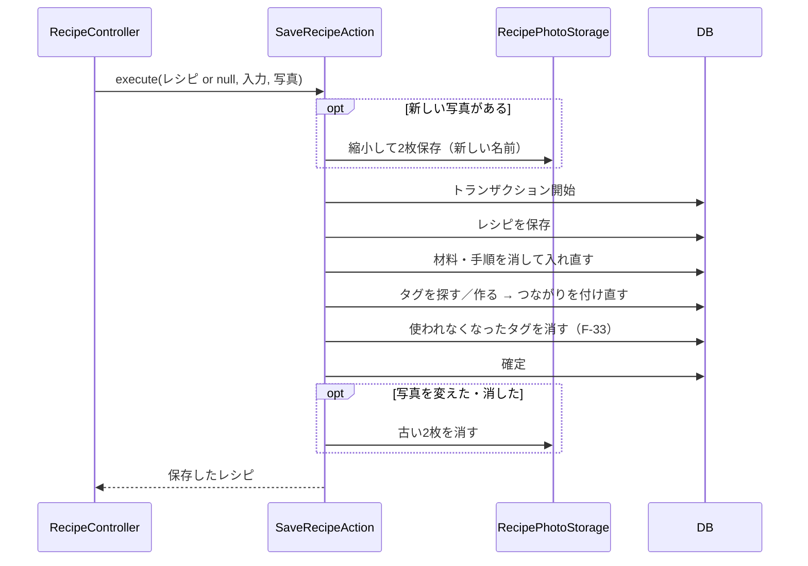

# 詳細設計書：レシピ管理アプリ

| 項目 | 内容 |
|---|---|
| 版 | 1.6 |
| 作成日 | 2026-11-03 |
| 状態 | 確定 |

基本設計（[要件定義書](requirements.md)・[技術スタック](tech-stack.md)・[画面設計書](screen-design.md)・[テーブル設計書](database-design.md)・[API 設計書](api-design.md)・[AWS 構成設計書](aws-design.md)）をもとに、実装に入れる細かさまで作り方を決める。**この文書だけを見て、実装を始められること**を目指す。

---

## 1. 決めたこと

| # | 項目 | 決定 | 理由 |
|---|---|---|---|
| 1 | 照合順序 | `utf8mb4_ja_0900_as_cs`（日本語用）。保存する前と検索するときに文字をそろえる（4.3） | MySQL 8.4.13 で試したところ、予定していた `utf8mb4_0900_ai_ci` は「はし」と「ばし」、「やま」と「ゃま」も同じとみなした（2章） |
| 2 | Node.js | 開発も本番も **Node.js 24**（長期サポート版、2028-04-30 まで）。パソコンは **fnm** でプロジェクトごとに切り替える | Amazon Linux 2023 に Node.js 26 がまだない（20・22・24 だけ）。開発と本番の版をそろえる |
| 3 | パソコンの PHP | **Laravel Herd**（PHP 8.5・Composer 入り）。MySQL だけ Docker | すでに入っている。Laravel 公式の、Windows で一番手軽な方法 |
| 4 | 画面のデータの取得 | **TanStack Query**（5.105） | 一覧と詳細を行き来するときのキャッシュ、保存後の取り直し、★ の楽観的更新を決まった書き方でできる |
| 5 | サーバーの処理の分け方 | **Laravel の標準＋複雑な処理だけ Action** | 公式の書き方に沿い、本当に複雑な3つ（保存・複製・削除）だけを1つの仕事ずつ切り出す（5.2） |

---

## 2. 確認したこと

### 2.1 照合順序（MySQL 8.4.13 で実際に試した結果）

| 比べたもの | `utf8mb4_0900_ai_ci` | `utf8mb4_ja_0900_as_cs` |
|---|---|---|
| 濁点「はし」と「ばし」 | 同じ | 区別する |
| 半濁点「はは」と「ぱぱ」 | 同じ | 区別する |
| 小さい字「やま」と「ゃま」 | 同じ | 区別する |
| ひらがな・カタカナ「じゃがいも」と「ジャガイモ」 | 同じ | 同じ |
| 全角・半角「ジャガイモ」と「ｼﾞｬｶﾞｲﾓ」 | 同じ | 区別する → 保存前にそろえる |
| 大文字・小文字「TOMATO」と「tomato」 | 同じ | 区別する → 検索のときだけ区別しない |

### 2.2 Amazon Linux 2023 で入れられる版（AWS の公式の説明）

| 技術 | 結果 |
|---|---|
| PHP | 8.1〜8.5 が入れられる。**8.5 を使う** |
| Node.js | 20・22・24 が入れられる。26 はまだない。**24 を使う**（1章の2） |

---

## 3. 開発環境

### 3.1 道具

| 道具 | 版 | 入れ方 | 使い道 |
|---|---|---|---|
| Laravel Herd | 最新 | 入れてある。PHP 8.5 を選ぶ | PHP・Composer |
| fnm | 最新 | winget で入れる | Node.js 24 を、このプロジェクトでだけ使う（`.node-version` に `24` と書く） |
| Docker Desktop | 29.9 | 入れてある | 開発用の MySQL 8.4 |
| Terraform・AWS CLI | 最新 | 入れてある | AWS（デプロイの工程） |

- PHP の拡張機能 `intl`（文字をそろえる処理に使う）と `gd`・`exif`（写真の縮小と向きの補正に使う）が有効か、環境構築で確かめる

### 3.2 ポート（決まった番号でだけ起動する）

| 番号 | 使うもの | 起動 |
|---|---|---|
| **3000** | Next.js（開発用のサーバー） | `frontend/` で `npm run dev` |
| **8000** | Laravel | `backend/` で `pwsh ./serve.ps1`（写真を 5MB まで送れるよう、PHP の設定を渡して起動する） |
| **3308** | MySQL 8.4（Docker） | ルートで `docker compose up -d` |

- 3306（別のプロジェクトの Docker）と 3307（Windows に入れた MySQL）は使わない。前のアプリの 5173・8080・5432 ともぶつからない
- ポートが使われていたら、使っているものを止めてから決まった番号で起動する（番号をずらさない）

### 3.3 開発中の通信の流れ

```
ブラウザ ─▶ http://localhost:3000（Next.js）
              ├─ 画面
              └─ /api/*・/sanctum/* ─（Next.js が転送）─▶ http://localhost:8000（Laravel）─▶ MySQL :3308
```

- ブラウザから見ると、画面と API が同じ住所（`localhost:3000`）になる。本番の「CloudFront → Nginx が振り分ける」と同じ形で、Sanctum の SPA 認証（同じドメインが前提）がそのまま動く
- 転送は Next.js の設定（`next.config.ts` の rewrites）で行う

### 3.4 データベース

| 項目 | 値 |
|---|---|
| 入れ物 | `compose.yaml`（ルート）。プロジェクト名 `recipebox` |
| DB | `recipe_app`（開発用）、`recipe_app_test`（テスト用） |
| ユーザー | `recipe_app_user` |
| パスワード | Windows のユーザー環境変数 `RECIPE_DB_PASSWORD`（中身は本人だけが知る）。`compose.yaml` と Laravel の `.env` がこれを読む |
| 文字コード・照合順序 | `utf8mb4`・`utf8mb4_ja_0900_as_cs`（サーバーの初期値として設定） |
| データ | Docker のボリュームに保存（`docker compose stop` では消えない） |

### 3.5 フォルダ構成（リポジトリ全体）

```
/
├─ backend/            Laravel（API）
├─ frontend/           Next.js（画面）
├─ infra/terraform/    AWS の構成（デプロイの工程で作る）
├─ docs/               設計書・モックアップ
├─ .github/workflows/  GitHub Actions（自動テスト・自動デプロイ）
├─ compose.yaml        開発用の MySQL
└─ README.md
```

---

## 4. サーバー（Laravel）

### 4.1 フォルダ構成（`backend/app/`）

```
app/
├─ Actions/                      複雑な処理（1つの仕事ずつ）
│   ├─ SaveRecipeAction.php        登録・編集の保存
│   ├─ CopyRecipeAction.php        複製
│   └─ DeleteRecipeAction.php      削除（写真・タグの片付けつき）
├─ Console/Commands/
│   └─ CreateOwnerCommand.php      持ち主アカウントの作成（F-54）
├─ Http/
│   ├─ Controllers/Api/
│   │   ├─ AuthController.php       A-02 ログイン・A-03 ログアウト
│   │   ├─ MeController.php         A-04 持ち主・A-05 パスワード変更
│   │   ├─ CategoryController.php   A-06
│   │   ├─ TagController.php        A-07
│   │   ├─ RecipeController.php     A-08〜A-12
│   │   ├─ FavoriteController.php   A-13・A-14
│   │   ├─ RecipeCopyController.php A-15
│   │   └─ CookingLogController.php A-16〜A-18
│   ├─ Requests/                  入力チェック（Form Request）
│   │   ├─ LoginRequest.php
│   │   ├─ UpdatePasswordRequest.php
│   │   ├─ RecipeIndexRequest.php    一覧の検索条件
│   │   ├─ SaveRecipeRequest.php     登録・編集で共通
│   │   └─ StoreCookingLogRequest.php
│   └─ Resources/                 返す JSON（API Resource）
│       ├─ CategoryResource.php
│       ├─ TagResource.php
│       ├─ RecipeListResource.php    一覧の1件
│       ├─ RecipeResource.php        詳細
│       └─ CookingLogResource.php
├─ Models/                       Category・Recipe・Ingredient・Step・Tag・CookingLog・User
├─ Queries/
│   └─ RecipeQuery.php             一覧の検索・絞り込み・並び替えの組み立て（4.5）
└─ Support/
    ├─ TextNormalizer.php          文字をそろえる（4.3）
    └─ RecipePhotoStorage.php      写真の縮小・保存・削除・コピー（4.6）
```

### 4.2 処理の分け方

| 層 | 受け持つこと | 書かないこと |
|---|---|---|
| Form Request | 入力のチェック（だめなら Laravel が自動で 422） | DB の変更 |
| Controller | 受け付け、Action やモデルを呼ぶ、Resource で返す | 判断・複数の手順 |
| Action | いくつもの手順がある処理。トランザクションはここで張る | HTTP（要求・返事）のこと |
| Model（Eloquent） | テーブル1つの読み書き、つながり（`hasMany` など） | 画面の都合 |
| Resource | 返す JSON の形（API 設計書のとおり） | DB の変更 |

- Action にするのは 4.1 の3つだけ。お気に入り・作った記録・パスワード変更などは、Controller からモデルを直接使う
- 例外：ログイン（回数制限つき）は `LoginRequest` の中で確かめる（Laravel の標準の書き方）

### 4.3 文字をそろえる（TextNormalizer）

| 何をするか | 例 |
|---|---|
| Unicode の正規化（NFKC）。全角の英数字・記号を半角に、半角カタカナを全角に | `ｼﾞｬｶﾞｲﾓ` → `ジャガイモ`、`Ｔｏｍａｔｏ` → `Tomato`、`大さじ２` → `大さじ2` |
| 前後の空白を取る。続く空白を1つにまとめる | `　肉じゃが ` → `肉じゃが` |

- **使う項目**：料理名、よみがな、材料名、分量、タグ名、検索のキーワード（`q`）。作り方の文章とメモは、書いたままを残す（「①」が「1」になるなどを避ける）
- 保存する前（Form Request の `prepareForValidation`）にそろえる。そろえた後の文字で長さを数える
- 英字の大文字・小文字：検索では両方を小文字にして比べる（`LOWER(列) LIKE LOWER(?)`）。タグの「同じ名前か」も小文字で比べる
- 検索のキーワードの `%`・`_`（LIKE の特別な記号）は、ただの文字として扱う

### 4.4 ログイン（Sanctum の SPA 認証）

| 項目 | 決まり |
|---|---|
| 守り方 | `/api/*` のうち A-02 以外は `auth:sanctum`。ブラウザからの要求はセッション（クッキー）で確かめる |
| セッション | データベースに保存。操作しないまま120分で切れる。「ログイン状態を保持する」なら、Laravel の記憶のクッキー（remember）で長期間保つ |
| クッキー | HttpOnly（JavaScript から読めない）、SameSite=Lax、本番は Secure（HTTPS のときだけ送る） |
| 回数制限 | 「メールアドレス＋接続元の IP アドレス」ごとに1分に5回まで（Laravel の RateLimiter）。超えたら 429 |
| 画面以外からのログイン | Sanctum が画面からの要求と認めないとセッションも CSRF の確認も動かないので、A-02 は 403 で断る |
| ログイン成功 | セッションの番号を作り直す |
| パスワード変更 | 今のパスワードを確かめてから変え、ほかの端末のログインを切る（`logoutOtherDevices`） |
| 持ち主の作成 | `php artisan app:create-owner` でメールアドレスとパスワードを聞いて作る。すでに1人いれば断る |
| 本番の接続元の IP | CloudFront と Nginx を通るので、Laravel に「信頼できる中継」を設定し、本当の接続元の IP を使う |

### 4.5 一覧の検索（RecipeQuery）

- 料理名・よみがな・材料名のどれかに、キーワードが含まれるレシピ（材料は `EXISTS` で探す）
- 条件（カテゴリ・タグ・お気に入り・調理時間）は、送られたものだけを `AND` でつなぐ
- 最後に作った日は、`cooking_logs` から「レシピごとの最大の日付」を数えて並び替えと表示に使う（テーブル設計書 3.3）
- 一覧の1件に要るタグ・カテゴリは、まとめて読み込む（Eloquent の `with`）。1件ずつ問い合わせない（N+1 問題を防ぐ）
- `category_id`・`tag_id` は、数かどうかだけを確かめる。タグは使われなくなると消えるので、消えたタグの URL を開いてもエラーにせず0件にする
- `page` は 1000000 までとする。とても大きな数は、読み飛ばす件数の計算があふれる

### 4.6 写真（RecipePhotoStorage）

| 項目 | 決まり |
|---|---|
| 道具 | **Intervention Image 4**（画像の縮小・変換の部品）。PHP の `gd` を使う |
| 作るもの | 詳細用（横1200px）と一覧用（横400px）。元が小さければ大きくしない。どちらも WebP（画質80） |
| ファイル名 | ULID（ばらばらの名前）＋`.webp`。置き場所は `recipes/large/`・`recipes/thumb/` |
| 保存先 | Laravel の Storage。開発は `local`（`storage/app/private`）、本番は `s3` |
| URL | 60分の期限付きの URL（`temporaryUrl`） |
| 古い写真を消す順番 | 新しい写真の保存と DB の更新が成功してから（トランザクションが確定した後）消す |
| 失敗したとき | 新しい写真の保存後に DB で失敗したら、保存した新しい写真を消す |
| 写真の向き | スマホの写真の向きの情報（EXIF）に合わせて回してから保存し、位置情報などの情報は消す |
| 画素数の上限 | 5000万画素まで。容量が小さくても、画素数が多い画像は開くのに大量のメモリを使うので、入力チェックで断る |
| 読み取れない画像 | 形は画像でも中身が壊れていれば、入力の誤り（422）にする |
| 元の写真がない複製 | コピーできなければ、写真なしで複製する（複製そのものは失敗させない） |
| 表示 | Next.js の画像変換（`next/image`）は通さず `` で出す。サーバーで縮小済みで、URL も期限付きで変わるため |

### 4.7 レシピの保存（SaveRecipeAction）の流れ



- 途中で失敗したら DB は全部取り消し、新しく保存した写真も消す
- 画面は、材料名も分量も空の行だけを送らない。分量だけ書いた行は消さずに送り、「材料名を入力してください」と知らせる（入力を黙って捨てないため）
- 画面は空の項目を送らないので、送られなかった任意の項目（よみがな・調理時間・メモ・タグ）は空として保存する（編集で消せるように）
- タイムゾーンは `Asia/Tokyo`。API の日時は `+09:00` で返す（API 設計書 1.1）

### 4.8 エラーとログ

| 項目 | 決まり |
|---|---|
| 返す形 | API 設計書 1.3（Laravel の標準の形）。見つからない（ModelNotFound）は 404 `{"message": "見つかりません"}` |
| 文言 | `lang/ja/validation.php` に、使う決まりと項目名の日本語を書く。アプリの言語は `ja` |
| 500 のとき | 返事には中身を出さない。詳しい内容はログにだけ残す |
| ログ | `storage/logs/` に1日1ファイル、14日分。パスワード・クッキー・写真の中身は出さない |
| 本番のログの見方 | Session Manager で EC2 に入って見る（CloudWatch への送り出しは対象外） |

---

## 5. 画面（Next.js）

### 5.1 フォルダ構成（`frontend/src/`）

```
src/
├─ app/                          App Router（URL ＝ フォルダ）
│   ├─ layout.tsx                  全体（Mantine・TanStack Query・書体・通知の準備）
│   ├─ login/page.tsx              S-01
│   ├─ (main)/layout.tsx           ヘッダーつきの画面の共通部分
│   ├─ (main)/page.tsx             S-02 一覧（/）
│   ├─ (main)/recipes/new/page.tsx       S-04
│   ├─ (main)/recipes/[id]/page.tsx      S-03
│   ├─ (main)/recipes/[id]/edit/page.tsx S-05
│   ├─ (main)/settings/page.tsx    S-06
│   ├─ (main)/not-found.tsx・error.tsx   S-07（ヘッダーは (main)/layout.tsx が出す）
│   ├─ not-found.tsx               S-07（404。どの画面にも当てはまらない URL。ヘッダーをここで出す）
│   └─ error.tsx                   S-07（500。(main) の外で起きたとき）
├─ features/                     機能ごと
│   ├─ auth/                       ログイン・ログアウト・パスワード変更
│   ├─ recipes/                    一覧・詳細・フォーム（部品・API の呼び出し・TanStack Query の関数）
│   └─ cooking-logs/               作った記録
├─ shared/
│   ├─ api/client.ts               API を呼ぶ唯一の関数（5.3）
│   ├─ api/types.ts                API の型（API 設計書のとおり）
│   ├─ components/                 ヘッダー・確認ダイアログなど共通の部品
│   └─ theme.ts                    Mantine のテーマ（色・書体）
└─ proxy.ts                      ログインしていない人をログイン画面へ（5.4）
```

- 部品と CSS Modules（`Xxx.module.css`）は同じ場所に置く
- 画面はほぼすべて、ブラウザで動く部品（`'use client'`）にする（API をブラウザから呼ぶため。API 設計の質問3）

### 5.2 Mantine のテーマ

| 項目 | 決まり |
|---|---|
| 主な色 | 蜜柑（`#F08300`）をもとに10段階の色を作り、`mikan` として登録して主な色にする。ボタンの文字は藍墨（画面設計書 3.3） |
| 書体 | `next/font/google` で Zen Maru Gothic（見出し）と BIZ UDPGothic（本文）を読み込む。ビルドのときに取り込まれ、外部への通信は増えない |
| ダークモード | `defaultColorScheme="auto"`（端末の設定に合わせる） |
| フォーム | `@mantine/form`（9.7）。サーバーの 422 の `errors` を、そのまま各項目のエラーに入れる |
| 通知 | `@mantine/notifications`（9.7）。成功は緑で4秒、エラーは赤で自分で閉じるまで |
| 材料・手順の並び替え | **@dnd-kit/react**（0.5）。キーボードでも並び替えられる。版が 1.0 前なので、動かない点があれば `@hello-pangea/dnd` に切り替える |

### 5.3 API を呼ぶ関数（`shared/api/client.ts`）

すべての API はこの関数を通す。

| 受け持つこと | 内容 |
|---|---|
| 合言葉（CSRF） | データを変える要求の前に、合言葉のクッキー（`XSRF-TOKEN`）がなければ `/sanctum/csrf-cookie` をもらい、ヘッダー `X-XSRF-TOKEN` に入れる |
| 共通のヘッダー | `Accept: application/json`。クッキーを付ける（`credentials: 'same-origin'`） |
| 401 | ログイン画面へ移す（戻り先の URL を付ける） |
| 419 | 合言葉をもらい直して、1回だけやり直す |
| 422 | 項目ごとのエラーを持った「入力の誤り」として呼び出し元に返す（フォームが表示する） |
| 429・500・通信の失敗 | 赤い通知を出す |

### 5.4 ログインしていない人の扱い（F-61）

- `proxy.ts`（Next.js 16 で `middleware.ts` から名前が変わったもの）が、画面を出す前に `GET /api/me` を Laravel に問い合わせる。ブラウザのクッキーをそのまま付けて送る。Sanctum が画面からの要求と判断できるよう、`Origin` に画面の住所（`APP_URL`、なければ要求の住所）を入れる。Laravel が返したクッキーはブラウザへ渡す
- Laravel が止まっているなどで確かめられないときは、移動せずに画面を出す（データは API が守るので見えない）
- 401 なら `/login?next=開こうとした URL` に移す。ログイン画面は、ログインに成功したら `next` へ戻す（自分のサイトの中の URL だけ。外のサイトへは移さない）
- ログイン中に `/login` を開いたら一覧へ移す
- 本当の守りはサーバー側（全 API が `auth:sanctum`）。`proxy.ts` は表示の都合

### 5.5 TanStack Query の使い方

| 名札（queryKey） | 中身 | API |
|---|---|---|
| `['me']` | ログイン中の持ち主 | A-04 |
| `['categories']` | カテゴリ（変わらないので、取り直さない） | A-06 |
| `['tags']` | タグ | A-07 |
| `['recipes', 検索条件]` | 一覧 | A-08 |
| `['recipe', id]` | 詳細 | A-09 |
| `['cooking-logs', id]` | 作った記録の全部 | A-16 |

| 操作 | 成功したら「古い」と知らせる名札 |
|---|---|
| 登録・編集・複製 | `recipes`・`recipe`・`tags` |
| 削除 | `recipes`・`tags`（`recipe` は消す） |
| ★ | 先に表示を変える（楽観的更新）。失敗したら戻す。最後に `recipes`・`recipe` |
| 作った記録の追加・削除 | `recipe`・`cooking-logs`・`recipes` |

- 共通の設定：30秒は新しいとみなす（`staleTime`）。失敗したら1回だけやり直す。ウィンドウに戻ったら取り直す

### 5.6 一覧の検索条件

- 条件は URL に入れる（画面設計書 1章）。例：`/?q=豚肉&category_id=1&sort=name&page=2`
- キーワードは、入力が止まってから 0.3秒後に URL を変える（1文字ごとに API を呼ばない）
- 条件を変えたら `page` を1に戻す
- タイル・リストの切り替えは、ブラウザ（`localStorage`）に覚えさせる
- URL は `history.pushState` で変える。Next.js の `useSearchParams` に伝わるので、サーバーに画面を取りに行かず、すぐに切り替わる。キーワードは1文字ごとに履歴を増やさないよう `replaceState` にする
- 日本語の変換中は検索しない。確定してから 0.3秒後に検索する
- URL は手で書き換えられるので、決まりに合わない値は「指定なし」として読む（`/?sort=abc` でもエラーにしない）。ないページを開いたら最後のページへ移す
- 「一覧に戻る」のために、最後に見ていた一覧の条件を `sessionStorage` に入れる。読むときも同じ決まりで確かめ、一覧の条件以外は捨てる

### 5.7 そのほかの決まり

- TypeScript で書く。`any` は使わない
- `dangerouslySetInnerHTML` は使わない（メモなどの文字は、そのまま文字として出す）
- Enter で送る入力欄（タグ）は、日本語の変換中（`isComposing`）は送らない
- 画面の文言・通知は画面設計書のとおり

---

## 6. コードの品質

### 6.1 自動のチェック

| 対象 | 道具 | 内容 |
|---|---|---|
| サーバー | **Laravel Pint**（1.32） | 書き方をそろえる（Laravel の標準の決まり） |
| サーバー | **Larastan**（3.14、PHPStan の Laravel 版） | 型の誤りなどを、動かす前に見つける。厳しさはレベル6から始める |
| 画面 | **Biome**（2.6） | 書き方のそろえとチェックを1つの道具で行う（前のアプリは oxlint と Prettier の2つ） |
| 画面 | TypeScript（`tsc --noEmit`） | 型の誤り |

### 6.2 テスト

| 種類 | 道具 | 書くもの |
|---|---|---|
| サーバー | Pest | 全 API について：ログインなしは 401、入力の誤りは 422、正しく動くこと。特に、保存（材料・手順・タグ・写真・タグの片付け）、複製、削除（写真が消える）、検索（濁点・ひらがなとカタカナ・全角と半角・大文字と小文字）、並び替え、回数制限。DB はテスト用の MySQL（`recipe_app_test`）。写真は Storage の偽物（`Storage::fake`）で確かめる |
| サーバー | Pest（単体） | TextNormalizer |
| 画面 | Vitest＋React Testing Library | ロジックのある部品：材料・手順の行の追加と削除、検索条件と URL の変換、API を呼ぶ関数（401・419・422 の扱い） |
| 通し | Playwright | ログイン → 登録 → 一覧に出る → 詳細 → 編集 → 作った記録 → 削除、ログインしていないとログイン画面に移る。Chrome・Firefox・Safari 系（WebKit）の3つで動かす |

- 変更したら、関係するテストを動かして結果を報告する

### 6.3 GitHub Actions

| 名前 | いつ | 内容 |
|---|---|---|
| `ci.yml` | PR を作った・更新したとき、main に入ったとき | backend（PHP 8.5・MySQL 8.4：Pint・Larastan・Pest）、frontend（Node.js 24：Biome・型・Vitest・ビルド）、e2e（両方を起動して Playwright） |
| `deploy.yml` | main に入り、`ci.yml` が成功したとき | 7章のデプロイ（AWS の構築が済んでから作る） |

- main の保護に「`ci.yml` の成功が必要」を足す（backend・frontend・e2e の3つのジョブ）
- MySQL は開発と同じ `compose.yaml` で起動する。GitHub Actions の `services`（ジョブと一緒に起動する仕組み）では、照合順序を決める起動オプションと、テスト用の DB を作る最初の SQL を渡せないため。パスワードは実行のたびに捨てる DB 用の値を `ci.yml` に書く（秘密の情報ではない）

---

## 7. デプロイ（AWS 構成設計書 7章の細かい手順）

### 7.1 GitHub Actions で作るもの

1. Laravel：`composer install --no-dev`（本番に要るものだけ）
2. Next.js：`next build`（`output: 'standalone'`。動かすのに要るものだけを1つのフォルダにまとめる設定）
3. 2つをまとめて1つのファイル（`release-<コミットの番号>.tar.gz`）にし、S3（デプロイ用）に置く
4. Systems Manager の Run Command で、EC2 のデプロイの手順書（スクリプト）を動かす

### 7.2 EC2 の中のフォルダ

```
/opt/recipe-app/
├─ releases/<コミットの番号>/   版ごとのフォルダ（新しいものを3つまで残す）
├─ current → releases/<今の版>  いま使っている版を指す印（シンボリックリンク）
└─ shared/
    ├─ .env                    Parameter Store から作る
    └─ storage/                Laravel のログ・キャッシュ（版をまたいで使う）
```

### 7.3 EC2 で動く手順

1. S3 からファイルを取り、`releases/<番号>/` に広げる
2. Parameter Store から読んで `shared/.env` を作り、`shared/` の中身をつなぐ
3. `php artisan migrate --force`（DB の変更）
4. `php artisan config:cache`・`route:cache`（設定を速く読めるようにする）
5. `current` を新しい版に付け替える
6. PHP-FPM と Next.js（systemd）を再起動する
7. `GET /api/me` が 401 を返すこと（＝ Laravel が動いていること）を確かめる。だめなら `current` を前の版に戻して、失敗を知らせる

- DB の変更（マイグレーション）は、前の版でも動く形（列を足すだけなど）にする。戻すときに DB は戻さないため

---

## 8. 本番の設定（`.env` の主な項目）

| 項目 | 値 | 置き場所 |
|---|---|---|
| `APP_ENV`・`APP_DEBUG` | `production`・`false` | デプロイの手順書 |
| `APP_KEY` | 秘密 | Parameter Store |
| `APP_URL` | `https://xxxx.cloudfront.net` | Parameter Store |
| `DB_HOST`・`DB_DATABASE`・`DB_USERNAME` | RDS の接続先 | Parameter Store |
| `DB_PASSWORD` | 秘密 | Parameter Store |
| `SESSION_DRIVER`・`SESSION_SECURE_COOKIE` | `database`・`true` | デプロイの手順書 |
| `SANCTUM_STATEFUL_DOMAINS` | CloudFront の住所 | Parameter Store |
| `FILESYSTEM_DISK`・`AWS_BUCKET` | `s3`・写真用バケット | Parameter Store |

- AWS の鍵は書かない。EC2 の役割（IAM）で S3 を使う
- Next.js のサーバーにも環境変数 `API_ORIGIN`（Laravel の住所）と `APP_URL`（CloudFront の住所）を渡す。`proxy.ts` が使う（5.4）

---

## 9. この文書で新しく決めたこと

質問で決めた5点（1章）のほかに、この文書で決めた点。2026-11-03 にユーザーの確認を受けた。

| 場所 | 内容 |
|---|---|
| 3.2 | ポートは Next.js 3000、Laravel 8000、MySQL 3308 |
| 3.4 | DB のパスワードは Windows のユーザー環境変数 `RECIPE_DB_PASSWORD`（前のアプリの `DB_PASSWORD` とは別） |
| 4.3 | 文字をそろえるのは料理名・よみがな・材料名・分量・タグ名・キーワード。作り方とメモは書いたまま |
| 4.4 | 操作しないまま120分でセッションが切れる（「保持する」なら長期間） |
| 4.6 | 写真の位置情報などは消して保存する。元の写真が小さければ大きくしない |
| 4.8 | ログは14日分。本番のログは EC2 の中に置く（CloudWatch には送らない） |
| 5.2 | 材料・手順の並び替えは @dnd-kit/react（前のアプリは @hello-pangea/dnd） |
| 5.6 | キーワードは入力が止まって0.3秒後に検索する |
| 6.1 | サーバーは Pint と Larastan（レベル6）、画面は Biome（前のアプリは oxlint と Prettier） |
| 6.3 | 通しのテスト（Playwright）も GitHub Actions で毎回動かす |
| 7.2 | 本番は版ごとのフォルダに置き、印（`current`）の付け替えで切り替える。失敗したら前の版に戻す |

---

## 10. 改訂履歴

| 版 | 日付 | 内容 |
|---|---|---|
| 0.1 | 2026-11-03 | 質問形式（質問1〜5）と確認の結果（2章）をもとに作成 |
| 1.0 | 2026-11-03 | ユーザーの確認（9章を含む）を受けて確定 |
| 1.1 | 2026-11-07 | 6.3 に CI の MySQL の起動方法を追加 |
| 1.2 | 2026-11-07 | ログインの実装に合わせて、4.4（画面以外からのログイン）・5.4（`proxy.ts` の問い合わせ）・8章（Next.js の環境変数）を追加 |
| 1.3 | 2026-11-07 | レシピの登録の実装に合わせて、4.7（空の行の扱い・タイムゾーン）・5.1（エラー画面の置き場所）を追加 |
| 1.4 | 2026-11-07 | 一覧の実装に合わせて、4.1（`RecipeQuery` の置き場所を `Queries/` に変更）・4.5（条件の確かめ方）・5.6（URL の変え方、決まりに合わない値、「一覧に戻る」）を更新 |
| 1.5 | 2026-11-07 | 編集の実装に合わせて、4.7（送られなかった任意の項目の扱い）を追加 |
| 1.6 | 2026-11-07 | 写真の実装に合わせて、3章（`exif`、Laravel の起動方法）・4.6（画素数の上限、読み取れない画像、複製、表示）を更新 |
