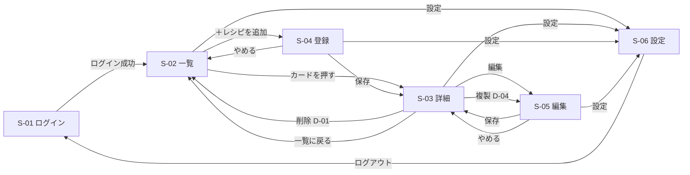

# 画面設計書：レシピ管理アプリ

| 項目 | 内容 |
|---|---|
| 版 | 1.0 |
| 作成日 | 2026-11-03 |
| 状態 | 確定 |

要件定義書（[requirements.md](requirements.md)）の機能を、どの画面でどう見せるかを決める。見た目は [モックアップ（mockups/index.html）](mockups/index.html) をブラウザで開いて確かめる。

---

## 1. 画面の一覧

S = 画面（Screen）、D = ダイアログ（画面の上に重ねて出す小さな窓）。

| ID | 画面 | URL | 主な要件 | モックアップ |
|---|---|---|---|---|
| S-01 | ログイン | `/login` | F-51・F-61 | [login.html](mockups/login.html) |
| S-02 | レシピ一覧 | `/` | F-01・F-07・F-11〜17 | [list.html](mockups/list.html) |
| S-03 | レシピ詳細 | `/recipes/{id}` | F-02・F-05〜07・F-41〜43 | [detail.html](mockups/detail.html) |
| S-04 | レシピ登録 | `/recipes/new` | F-03・F-21・F-31・F-32 | [form.html](mockups/form.html) |
| S-05 | レシピ編集 | `/recipes/{id}/edit` | F-04・F-22 | [form.html?edit](mockups/form.html?edit) |
| S-06 | 設定 | `/settings` | F-52・F-53 | [settings.html](mockups/settings.html) |
| S-07 | エラー | —（404・500） | N-03 | [error.html](mockups/error.html) |

| ID | ダイアログ | 出す画面 | 主な要件 |
|---|---|---|---|
| D-01 | レシピ削除の確認 | S-03 | F-05・N-04 |
| D-02 | 作った記録の追加 | S-03 | F-41 |
| D-03 | 作った記録の削除の確認 | S-03 | F-43・N-04 |
| D-04 | 複製の確認 | S-03 | F-06 |

- S-04 と S-05 は**同じフォームの部品**を使い回す
- 一覧の検索・絞り込み・並び替え・ページの条件は **URL に入れる**（例：`/?category=1&tag=時短&page=2`）。詳細から「一覧に戻る」で条件がそのまま戻り、ブラウザの「戻る」でも同じ状態になる

---

## 2. 画面の移り変わり

- ログインしていない人がどの URL を開いても S-01 に移す。ログインしたら、もともと開こうとした画面に戻す（F-61）
- ログイン中に S-01 を開いたら S-02 に移す
- 登録・編集の途中で「やめる」を押したとき、入力が変わっていれば「変更を捨てますか？」と確かめる

---

## 3. 全画面に共通の決まり

### 3.1 画面の幅と並び方

| 幅 | 呼び方 | 並び方 |
|---|---|---|
| 〜640px | スマホ | 1列。ヘッダーはハンバーガーメニュー。一覧のタイルは2列 |
| 641〜1000px | タブレット | 一覧のタイルは2〜3列。詳細は 860px 以下で1列 |
| 1001px〜 | パソコン | 一覧のタイルは4列。詳細は左右2列 |

- 横幅 **320px** でも、横にはみ出したり崩れたりしないこと（N-01）
- 内容の最大幅は 1200px（登録・編集・設定は読みやすさのため 760px）

### 3.2 ヘッダー（S-01 以外）

| 部品 | パソコン | スマホ |
|---|---|---|
| アプリ名「Recipe Box」 | 左。押すと一覧へ | 同じ |
| ＋レシピを追加 | 右にボタン | ハンバーガーメニューの中 |
| 設定 | 右にリンク | ハンバーガーメニューの中 |

ヘッダーは画面を下に動かしても上に残る。

### 3.3 色

| 用途 | 色 |
|---|---|
| メインの色（ボタン・リンク・番号） | オレンジ（Mantine の orange） |
| 削除など危険な操作 | 赤（枠だけのボタンにし、押してから確認ダイアログで本当に消すか聞く） |
| お気に入り | 黄色の ★ |

ダークモードは端末の設定に合わせて切り替わる（Mantine の仕組みを使う）。

### 3.4 通知

| 種類 | 色 | 消え方 | 例 |
|---|---|---|---|
| 成功 | 緑 | 4秒で自動で消える | 「保存しました」「削除しました」「記録しました」 |
| エラー | 赤 | 自分で閉じるまで残る | 「保存できませんでした。時間をおいてもう一度お試しください」 |

- 出る場所：パソコンは右上、スマホは上の中央
- 入力の誤りは通知ではなく、**その項目のすぐ下に赤い文字**で出す。あわせて、フォームの上に「入力に誤りがあります」とまとめて出す（N-03）

### 3.5 読み込み中・空のとき

- データを読み込んでいる間は、カードの形をした灰色の仮の表示（スケルトン）を出す
- 保存ボタンを押したあとは、終わるまでボタンを押せなくし、くるくる回る印を出す（二重登録を防ぐ）
- 一覧が0件のときは「条件に合うレシピがありません」と、登録画面へのリンクを出す。レシピがまだ1件もないときは「最初のレシピを追加しましょう」と出す

---

## 4. 画面ごとの内容

### S-01 ログイン

| 項目 | 部品 | 決まり |
|---|---|---|
| メールアドレス | 入力欄 | 必須 |
| パスワード | 入力欄（伏せ字） | 必須 |
| ログイン状態を保持する | チェックボックス | 最初からオン |
| ログイン | ボタン | |

- ヘッダーは出さない
- 失敗したら「メールアドレスかパスワードが違います」と出す（どちらが違うかは教えない。他人に推測されないため）
- 失敗が続いたら「しばらく受け付けません。1分後にもう一度お試しください」と出す（N-23）

### S-02 レシピ一覧

上から順に：

1. **検索・絞り込みの欄**
   - パソコン：キーワード（1行目）、カテゴリ・タグ・調理時間・お気に入りだけ・条件をクリア（2行目）
   - スマホ：キーワードと「絞り込み (n)」ボタンだけ。ボタンで画面の下から窓を出し、残りの条件を選ぶ。(n) は選んでいる条件の数
   - キーワードは入力が止まって少し経ったら自動で検索する（ボタンを押さなくてよい）
2. **件数・並び替え・表示の切り替え**
   - 「主菜 ｜ 24件中 1〜20件」のように、条件と件数を出す
   - 並び替え：新しい順（初期値）・料理名順・調理時間の短い順・最後に作った日が古い順
   - タイル ▦ ／ リスト ☰ の切り替え。選んだ形はブラウザに覚えさせる
3. **レシピ**
   - タイル：写真（4:3）・料理名・カテゴリ・調理時間・タグ・★。スマホではタグを省く
   - リスト：小さな写真・料理名・カテゴリ・調理時間・タグ・★
   - ★ は押すとその場でお気に入りを切り替える（F-07）
4. **ページ分け**：20件ずつ

### S-03 レシピ詳細

| 場所 | 内容 |
|---|---|
| 上 | 「一覧に戻る」、料理名、ボタン（お気に入り・作った・編集・複製・削除） |
| 左（スマホは上） | 写真、カテゴリ・調理時間・タグ、材料（何人分） |
| 右（スマホは下） | 作り方（番号つき）、メモ、作った記録 |

- 料理中にスマホで読むことを考え、材料と作り方は**文字を少し大きく（17px）、行の間を広く**する
- 作った記録：回数・最後に作った日、記録の一覧（新しい順に3件、「もっと見る」で全部）。各記録に削除ボタン
- メモや作った記録がないときは、その欄を出さないか「まだありません」と出す

### S-04 レシピ登録 ／ S-05 レシピ編集

| 欄 | 部品（Mantine） | 決まり |
|---|---|---|
| 料理名 | TextInput | 必須、100文字まで |
| カテゴリ | Select | 必須、12個から1つ |
| 何人分 | NumberInput | 必須、1〜99。初期値 2 |
| 調理時間（分） | NumberInput | 1〜999 |
| タグ | TagsInput | 10個まで、1つ20文字まで。今までのタグを候補に出し、新しい名前ならそのまま新しいタグになる |
| 完成写真 | Dropzone | JPEG・PNG・WebP、5MB まで。編集では今の写真と「写真を変える」「写真を削除」 |
| 材料 | 名前＋分量の行 | 1〜50行。行の追加・削除・ドラッグで並び替え |
| 作り方 | 番号つきの文章の行 | 1〜50行。1行500文字まで。行の追加・削除・ドラッグで並び替え |
| メモ | Textarea | 2000文字まで |

- 保存・やめるのボタンは、画面の下に固定する（長いフォームでも押しやすいように）
- 保存したら詳細画面（S-03）に移り、「保存しました」の通知を出す
- 入力の誤りは、項目の下とフォームの上に出す（3.4）
- 複製（D-04）のあとは、コピーしたレシピの編集画面として開く

### S-06 設定

| 欄 | 内容 |
|---|---|
| パスワードの変更 | 今のパスワード、新しいパスワード（8文字以上）、新しいパスワード（確認） |
| ログアウト | ログイン中のメールアドレスを出し、ログアウトボタン |

### S-07 エラー

| 種類 | 文言 | ボタン |
|---|---|---|
| 404 | ページが見つかりません。レシピが削除されたか、URL が間違っている可能性があります | レシピ一覧へ |
| 500 | エラーが起きました。時間をおいて、もう一度お試しください | 再読み込み、レシピ一覧へ |

---

## 5. ダイアログ

| ID | タイトル | 内容 | ボタン |
|---|---|---|---|
| D-01 | レシピを削除しますか？ | 材料・作り方・作った記録・写真もすべて消え、元に戻せません | やめる ／ **削除する**（赤） |
| D-02 | 作った記録を残す | 作った日（必須、初期値は今日、未来の日付は選べない）、ひとことメモ（200文字まで） | やめる ／ **記録する** |
| D-03 | この記録を削除しますか？ | ○○/○○ の記録を削除します。元に戻せません | やめる ／ **削除する**（赤） |
| D-04 | このレシピを複製しますか？ | 「○○（コピー）」を作り、編集画面を開きます。お気に入りと作った記録はコピーしません | やめる ／ **複製する** |

- 窓の外を押すか Esc キーで閉じる（「やめる」と同じ）

---

## 6. この文書で新しく決めたこと（要件定義書にない細かい点）

質問では決めず、この文書で決めた点。2026-11-03 にユーザーの確認を受けた。

| 場所 | 内容 |
|---|---|
| 1章 | 検索の条件を URL に入れる（戻ったときに条件が残る） |
| 2章 | 登録・編集を「やめる」とき、変更があれば確かめる |
| 4章 S-01 | 「ログイン状態を保持する」は最初からオン。失敗が続いたときの待ち時間は1分 |
| 4章 S-02 | キーワードは入力が止まったら自動で検索する |
| 4章 S-03 | 作った記録は3件まで出し、「もっと見る」で全部 |
| 4章 S-06 | 新しいパスワードは8文字以上 |
| 5章 D-02 | 作った記録のメモは200文字まで。未来の日付は選べない |

---

## 7. 改訂履歴

| 版 | 日付 | 内容 |
|---|---|---|
| 0.1 | 2026-11-03 | 質問形式で決めた画面の一覧・並べ方・色をもとに作成。モックアップ（mockups/）を追加 |
| 1.0 | 2026-11-03 | ユーザーの確認（6章を含む）を受けて確定 |
